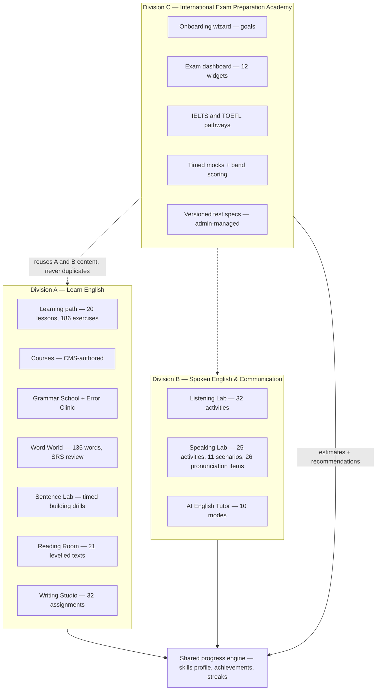
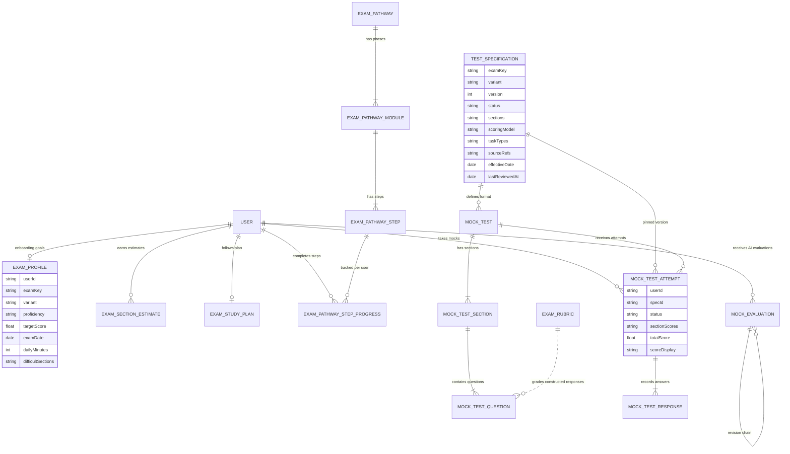
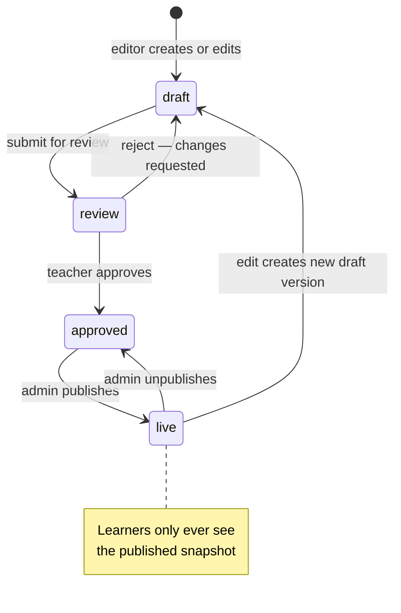
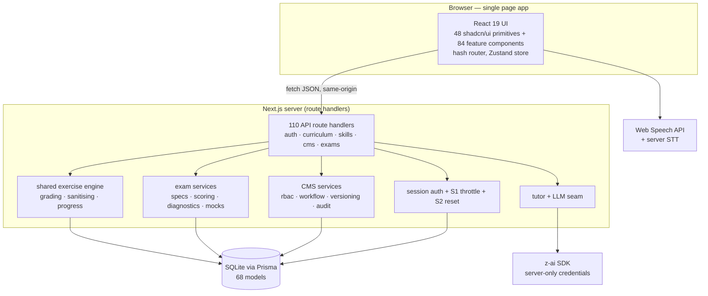
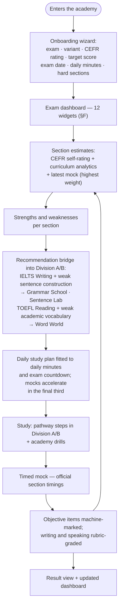
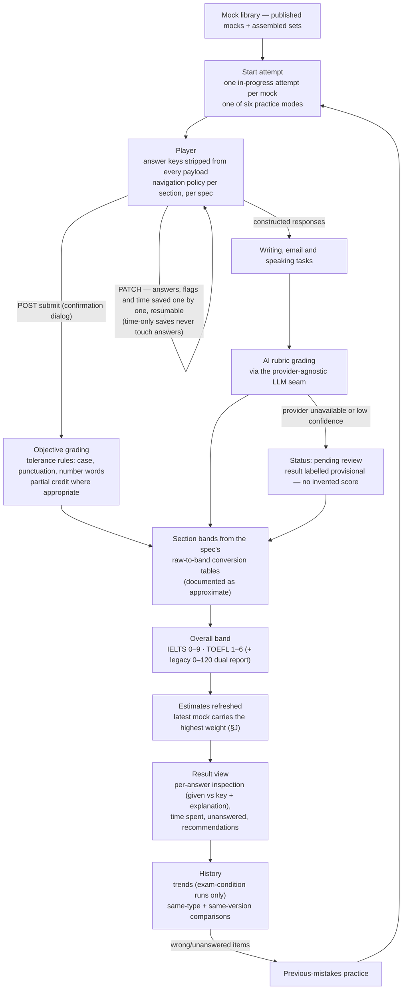
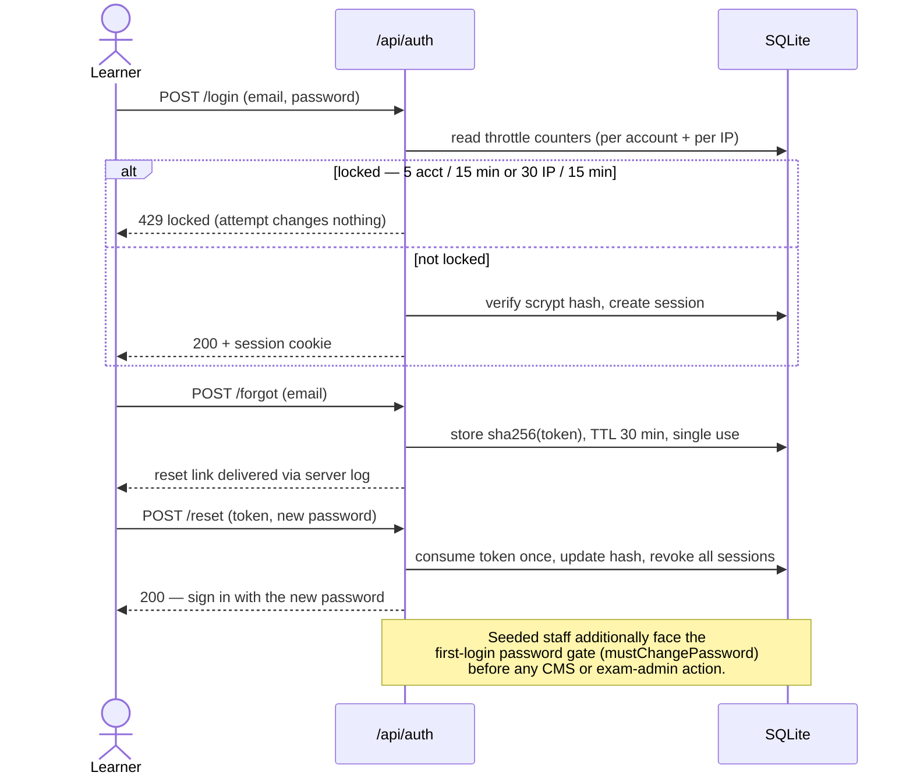
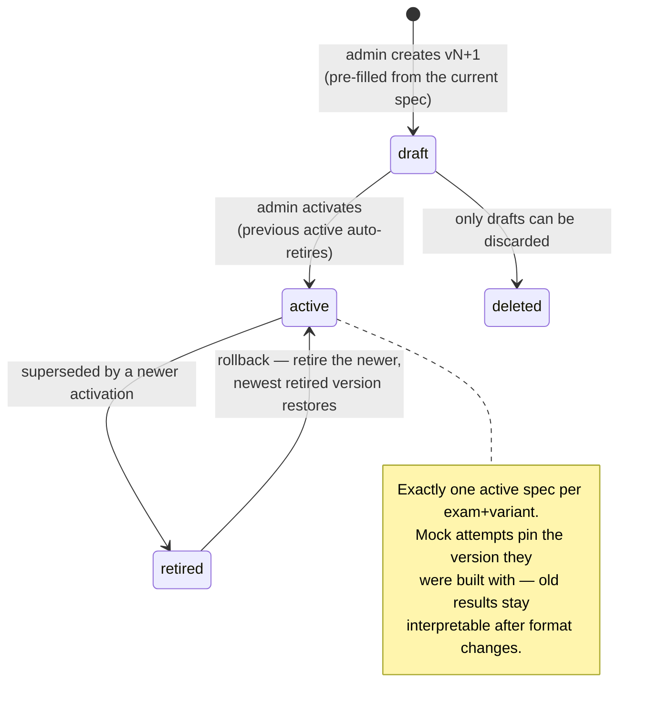

# EnglishPath — Learn English. Communicate. Prove it.

**EnglishPath** takes a learner from their first English word to confident
communication — and on to an internationally recognised examination score.
It is a complete ESL learning platform: a structured core curriculum, six
skill laboratories (grammar, sentence construction, reading, listening,
speaking, writing), the Word World vocabulary environment, a ten-mode AI
English tutor, a full administrative content management system, and a
dedicated **International Exam Preparation Academy** (IELTS and TOEFL iBT).
Everything is backed by a server-graded exercise engine that never leaks
answer keys to the client.

> **Status (2026-11-13):** functionally complete, 502 unit/route tests green,
> 79/79 staging smoke checks green under an exact Vercel simulation,
> production build verified. Honest open items are listed in §R and §Y.
> A public demo runs in serverless demo mode at
> <https://talksy-peach.vercel.app> — as of this writing it still runs the
> pre-exam-academy build (probe: `GET /api` → 200, `GET /api/exams/overview`
> → 404); redeploy with `vercel --prod` to include Division C.

The platform is organised into **three divisions**:

| Division | Name | Scope |
| --- | --- | --- |
| **A** | Learn English | Learning path, CMS courses, Word World, Grammar School, Sentence Lab, Reading Room, Writing Studio |
| **B** | Spoken English & Communication | Listening Lab, Speaking Lab, AI English Tutor |
| **C** | International Exam Preparation Academy | IELTS & TOEFL iBT pathways, exam dashboard, timed mock tests with band scoring, versioned test specifications |

This README is organised **A–Y**: each letter is one section. §V lists how to
reproduce every number quoted here, and §Y is the meta report on how this
document was produced.

---

## A — About EnglishPath

EnglishPath exists because a learner's journey has three distinct phases that
most products blur together: *acquiring* the language (grammar, vocabulary,
the four skills), *using* it (listening, speaking, real conversation), and
*certifying* it (IELTS, TOEFL iBT). Each phase needs a different environment,
different feedback and a different tone — so EnglishPath gives each phase its
own division (§C) while keeping **one account, one progress record and one
shared curriculum**. The exam academy (Division C) never duplicates the core
curriculum: when an exam candidate is weak at sentence construction, the
academy sends them back to Grammar School; when academic vocabulary is the
gap, it sends them to Word World (§J, §K).

What the running system consists of today (all counts verified from the
repository on 2026-11-12 — see §V and §Y):

| Dimension | Count |
| --- | --- |
| Learner-facing environments | 12 (learning path, courses, Word World, six skill labs, tutor, progress, exam academy) |
| API route handlers | 125 (`src/app/api/**/route.ts`) |
| Prisma data models | 72 (54 core + 18 exam-academy models) |
| Content-as-code lessons / exercises | 20 lessons / 186 exercises across 16 exercise types |
| IELTS Academy (CMS courses) | 3 courses (Core + Academic track + General Training track) · 55 lessons · 94 question-bank exercises |
| Vocabulary / reading / listening / speaking / writing items | 135 words · 21 texts · 32 activities · 25 activities + 11 conversation scenarios · 32 assignments |
| Exam academy | 3 active test specifications (IELTS Academic, IELTS General Training, TOEFL iBT 2026 format — versioned & history-preserving, retired versions never re-graded) · 3 pathways (226 steps) · 45 published mocks (488 original questions, every item with difficulty + explanation) · 7 masterclass practice banks incl. the 400-item TOEFL practice library (100 Reading + 100 Listening + 200 Writing + 100 Speaking, all machine-validated originals) |
| AI evaluation system | 10 examiner profiles (IELTS writing ×4, IELTS speaking, TOEFL writing ×3, TOEFL speaking ×2) · 4 provenance labels · revision-tracked improvement chains |
| Study planner | 7/14/30/60/90/custom-day adaptive plans · baseline diagnostic with evidence basis · 4 honest readiness labels · in-app reminders |
| Exam administration | question review workflow (draft → in-review → approved → published, role-gated + audit-logged) · 4 content collections with live inventories · spec version workflow with impact reports & mock relinking · live database analytics |
| Tests | 502 unit/route tests + 973 browser E2E checks + 79 staging smoke checks (65 exam academy + 14 deployment) |
| UI | 48 shadcn/ui primitives + 87 feature components |

Design principles that shape every feature (§E): grading happens
**server-side only**; exam formats are **versioned data, never hardcoded**;
measured results and AI suggestions are **strictly separated**; uncertain AI
explanations are never presented as verified facts; and unknowable numbers
are displayed as "—" rather than guessed.

## B — Brand, naming & trademarks

- **EnglishPath** is the product brand used in product documentation (this
  README, `docs/PRD.md`, `docs/EXAM_ACADEMY.md`) and in the academy's
  content credits ("original EnglishPath practice materials").
- The **application shell still carries the legacy working name "TalkSy"** in
  some visible strings (browser title, logo, login copy) and in internal,
  non-user-facing identifiers: the `talksy_session` cookie name, the
  `@talksy.app` seed-account domain, the `talksy-cms-export` bundle format,
  and the `/tmp/talksy` serverless staging directory. The brand migration to
  EnglishPath across UI strings is a planned, deliberately low-risk change
  (§R); until then, "TalkSy" in the interface refers to this same product.
- **Trademarks.** IELTS is jointly owned by the British Council, IDP: IELTS
  Australia and Cambridge University Press & Assessment. TOEFL and TOEFL iBT
  are registered trademarks of Educational Testing Service (ETS). EnglishPath
  is not affiliated with, endorsed by or associated with any of them. All
  practice questions and mock materials are original content authored for
  this platform; format data references the official provider pages recorded
  in each specification's `sourceRefs`.

## C — Composition: the three divisions



**Division A — Learn English** is the common curriculum: the ordered
learning path (Pre-A1 → A1 → Grammar Core; the A2 level is a declared
placeholder with no units yet), staff-authored courses via the CMS, and the
five dedicated environments — Word World, Grammar School, Sentence Lab,
Reading Room and Writing Studio. Progress is earned by completing lesson
sections and passing server-graded assessments — never by opening pages.

**Division B — Spoken English & Communication** develops the interactive
skills: the Listening Lab (word recognition → dialogue comprehension), the
Speaking Lab (guided activities, pronunciation training, AI conversation
scenarios with scripted fallback, measurement reports) and the AI English
Tutor, which also serves Divisions A and C as the always-available practice
partner.

**Division C — International Exam Preparation Academy** is a deliberately
premium, distinct experience — landing page, onboarding, dashboard, course
pages, mock library and a timed player of its own (§J, §M, §T). IELTS and
TOEFL iBT are prepared **completely separately**: separate course structures,
blueprints, question types, timing rules, scoring systems, practice
exercises, mock configurations and feedback rubrics. Nothing is
interchangeable between the two exams. On top of the shared simulation
engine sits an **AI-assisted writing & speaking evaluation system** (10
examiner profiles, four provenance labels, revision-tracked improvement
chains) that grades constructed responses against the right rubric for the
exam, task and section — always as practice feedback, never as an official
score. A **personalized study planner** closes the loop: it turns the
initial assessment and a baseline diagnostic into adaptive 7–120-day
day-by-day plans (weighted toward the weakest sections), re-weights future
days when mocks show repeated weaknesses, and reports readiness with four
honest labels — never a guaranteed score.

## D — Data model

One SQLite database accessed exclusively through Prisma ORM (no string SQL
in app code). 69 models in three clusters:

| Cluster | Models (count) | Contents |
| --- | --- | --- |
| Accounts & security | User, Session, AuthThrottle, PasswordResetToken (4) | scrypt hashes, DB sessions, S1 throttling, S2 reset tokens |
| Learner activity | progress, notes, attempts, SRS logs, bookmarks, word lists, reading/listening/speaking/writing runs, tutor conversations, goals, achievements, certificates (35) | every skill environment's state |
| CMS + Exam academy | CMS levels, courses, modules, units, lessons, blocks, versions, prerequisites, questions, assets, enrolments, progress, submissions, audit (15) + exam domain (15) | authored content and Division C |

The exam domain (15 models, `prisma/schema.prisma` lines 1069–1360):



Design rules: SQLite has no enums, so every enum-like column is a string
validated by Zod schemas in `src/lib/exams/types.ts` — the single parser for
every structured JSON column. Constructed-response **answer keys live only
in server-side tables** and are stripped from every client projection
(§E, §M). Each attempt **pins the specification version** it was built with,
so old results stay interpretable after a format change (§T).

## E — Engineering guarantees

These invariants are enforced in code and covered by tests:

1. **Server-side grading only.** Exercise answers are submitted to API
   routes; sanitised exercise payloads never contain answer keys, feedback
   or grading keywords (unit-tested per environment, e.g.
   `writing.test.ts` "no model texts or grading keywords reach the client").
2. **Exam formats are data.** No exam rule is hardcoded in a frontend
   component; components read specifications only through
   `src/lib/exams/*` services (§T).
3. **Deterministic vs AI separation.** Measured scores (grading engine,
   band arithmetic) are strictly separated from AI-generated suggestions,
   which always carry a disclaimer. Uncertain AI grammar explanations are
   never presented as verified facts; tutor prompts forbid it.
4. **Published snapshots.** Learners always see the published snapshot of
   CMS content, never a working copy; historical assessment data pins the
   content version it was graded against and is never rewritten.
5. **Test-database guard.** `src/lib/db.ts` refuses to run tests when
   `NODE_ENV=test` resolves to the development database — a bare `bun test`
   would corrupt the seed database that ships inside serverless
   deployments. Always use `bun run test` (points at `db/test.db`).
6. **Unknowable values show "—".** CMS analytics render only live database
   aggregates; anything not knowable is displayed as an em dash, never
   estimated.
7. **Prisma everywhere.** No `$queryRaw`/string SQL in app code.

## F — Feature reference

Learner-facing environments (routes in §N):

| Environment | What it does | Notable specifics |
| --- | --- | --- |
| Learning path (`#/library`) | 20 code-based lessons in 4 levels (Pre-A1 4 · A1 2 · Grammar Core 14; A2 declared, no units yet) | 20 block types, each lesson ends in a server-graded assessment; difficulty curve easy 62 / medium 80 / hard 34 / challenge 10 (FINAL_REPORT §3) |
| Courses (`#/courses`) | CMS-authored courses with levels, modules, units, lessons, prerequisites, enrolments | learners see the published snapshot only |
| Word World (`#/vocabulary`) | 135 words in 12 categories | SM-2-style spaced repetition, 8 tabs (today/explore/flashcards/context/relationships/sentences/challenges/lists), custom lists, daily challenges |
| Grammar School (`#/grammar`) | parts-of-speech modules, 12-tense explorer | Error Clinic diagnoses submitted sentences and recommends lessons |
| Sentence Lab (`#/lab`) | 7-stage construction programme | timed accuracy challenges, word tiles, structure annotation |
| Reading Room (`#/reading`) | 21 levelled texts (Pre-A1–A2 band) | glossaries, comprehension questions with skill tags, progress tracking |
| Listening Lab (`#/listening`) | 18 activities | word recognition → dialogue comprehension; original audio |
| Speaking Lab (`#/speaking`) | 25 activities in 4 bands, 11 conversation scenarios, 26 pronunciation items | recordings never stored; transcripts respect a 0–365-day retention setting and are deletable; AI partner with scripted fallback |
| Writing Studio (`#/writing`) | 31 progressive assignments in 4 tiers | autosave, drafts, structured 10-dimension feedback, revision compare; writing scores stay separate from the general level |
| AI Tutor (`#/tutor`) | 9 teaching modes | level-aware, Socratic, lesson-aware, streaming replies; per-user limits: 60 messages/day, 1 message/1.5 s |
| My Progress (`#/progress`) | analytics dashboard | skill profiles, revision scheduler, 46 achievements (11 milestones + 35 badges), certificates, streaks that never reset real progress |
| Exam Academy (`#/exams`) | Division C | onboarding wizard, 12-widget dashboard, per-exam course pages with separate Academic and General Training tracks, mock library (24 mocks), timed and untimed practice modes, band-scored results (§J–§T) |

Staff-facing: the admin CMS (`#/admin`, §G) including the exam-specification
tab (§T).

## G — Governance: the admin CMS

Four roles, enforced **server-side on every route** (the client-side gate is
cosmetic only): `student` < `editor` < `teacher` < `admin`. Editors author,
teachers review/approve, admins publish and manage users. Every workflow
action writes an append-only row to `CmsAuditLog` (viewable in the CMS).

Content lifecycle (identical shape for courses, lessons and questions —
`src/lib/cms/service.ts`):



Other CMS capabilities: lesson editor with 15 structured block kinds;
question bank covering all 16 exercise types with review workflow and
version history; audio/image uploads (25 MB, MIME allowlist, duration,
transcript, IPA, licence, source); user management (roles, suspension,
aggregate-only progress monitoring — no password hashes, no per-learner
content exposure); course JSON import/export with validation, preview and
no-overwrite semantics; dashboard analytics (live aggregates only, §E.6).
Since the exam academy, the CMS also hosts **test-specification management
and the mock-test lifecycle** (§T).

## H — High-level architecture

One Next.js application, one public route, one database:



Hash routing keeps the whole learner app on the single public `/` route
(ADR-003, §N) — one deployable entry point, multi-page behaviour, and SSR
that always renders the home route without hydration mismatches. AI
features go through a provider-agnostic seam (`src/lib/llm`) so the z-ai SDK
stays confined to server modules; when credentials or the provider are
unavailable, AI features degrade gracefully (scripted conversation
fallback, null AI suggestions with measured feedback intact, "awaiting
review" for exam constructed responses) rather than failing.

## I — Installation & configuration

Requirements: Bun 1.1+ (recommended) or Node.js 20+; a modern browser
(Web Speech features need Chrome/Edge/Safari; localhost counts as a secure
context for microphone access).

```bash
git clone <repository-url> englishpath && cd englishpath
bun install
bun run db:push             # create the SQLite schema
bun run dev                 # http://localhost:3000
```

Configuration is intentionally minimal:

- `DATABASE_URL` (optional locally) — SQLite file path. Unset, it defaults
  to the repository's `db/custom.db`; the bundled `.env` sets it to that
  same file. Tests always use `db/test.db` via `bun run test`.
- No other environment variables. AI credentials live in a server-side SDK
  configuration file, never exposed to the client.

The first login provisions the self-healing seed — idempotently re-checked
on every login: three staff accounts (`admin@` / `editor@` /
`teacher@talksy.app` — public default passwords in `src/lib/cms/seed.ts`,
forced change on first login) and the starter CMS course. The demo learner
(`demo@talksy.app` / `demo1234`, advertised on the login screen) is
re-created on demand if missing.

Database lifecycle commands (`prisma db push` for dev, `migrate dev` /
`migrate deploy` for production), backups and rollback: §O and
`docs/DEPLOYMENT.md`.

## J — Journeys

Three personas (full PRD in `docs/PRD.md`), one platform:

- **Absolute beginner ("Sofia")** — registers, lands on the learning path at
  Pre-A1 "Hello!", follows guided lesson ordering with translations and
  per-line audio, graduates into Grammar Core. No placement test exists
  (§R); the path is ordered and progress-driven instead.
- **Communicator ("Diego")** — has grammar but freezes when speaking: lives
  in Division B (Listening Lab, Speaking Lab conversations with the AI
  partner and measurement reports, Tutor conversation mode).
- **Exam candidate ("Amara")** — enters Division C: onboarding wizard
  (which exam → variant → CEFR self-rating → target score → exam date →
  daily minutes → most difficult sections), then works the loop below.
  Goals can be changed at any time; switching exam resets estimates and
  pathway progress for honesty.



The loop is the product: mock evidence sharpens estimates, estimates drive
recommendations, recommendations route the candidate back into the common
curriculum — which is never duplicated (§K "the bridge").

## K — Key concepts

| Concept | Meaning |
| --- | --- |
| Content-as-code | The curriculum, grammar, vocabulary, reading, listening, speaking and writing libraries are typed TypeScript modules (`src/data/**`) — compiled, validated and versioned with the app; no seeding step needed |
| Published snapshot | Learners see only published CMS content; the working copy is invisible until an admin publishes |
| Versioned test specification | An exam's format is a database record with a version, status, effective date and source references — not code (§T) |
| Spec pinning | Every mock attempt records which spec version it was built with; historical results stay interpretable after format changes |
| The bridge | The rule table + recommendation flow that maps exam weaknesses to common-curriculum lessons; the anti-duplication mechanism of Division C |
| Band arithmetic | IELTS: 0–9 per section, overall = mean of four rounded to the nearest half (quarters round up). TOEFL iBT (2026 format): 1–6 bands per section with the same mean-and-half rounding, dual-reported with the legacy 0–120 scale during the 2026–2028 transition |
| Safe projection | Server-side view of an exercise or mock question with answer keys, feedback and grading keywords stripped before anything reaches the client |
| SRS | Spaced-repetition scheduling of vocabulary review (SM-2 style) |
| Streaks that never punish | Missing days never resets real progress; streaks are encouragement, not a penalty system |
| Serverless demo mode | On Vercel, the bundled seed database is copied to writable `/tmp` once per function instance so a read-only host still works; data is ephemeral by design (§O) |

## L — Learning content inventory

<<<<<<< HEAD
=======
<<<<<<< HEAD
>>>>>>> 2b1168b3cb6064a05edf09310c505cf6efb21e8a
All counts computed from the repository on 2026-11-12
(`bun scripts/readme-facts.ts`, §V):

| Content | Count | Source module |
| --- | --- | --- |
| Curriculum lessons | 20 (Pre-A1 4 · A1 2 · Grammar Core 14) | `src/data/curriculum` |
| Lesson block types | 20 (all 20 used) | `src/data/curriculum/types.ts` |
| Exercise types | 16 (all 16 used) | `src/data/curriculum/types.ts` |
| Curriculum exercises | 186 (122 grammar-weighted) | `src/data/curriculum` |
| CMS lesson block kinds | 15 | `src/data/cms/types.ts` |
| Vocabulary words / categories | 135 / 12 | `src/data/vocabulary` |
| Reading texts | 21 (Pre-A1–A2 band) | `src/data/reading` |
| Listening activities | 18 | `src/data/listening` |
| Speaking activities / scenarios / pronunciation items | 22 / 11 / 26 | `src/data/speaking` |
| Writing assignments | 31 (4 tiers) | `src/data/writing` |
| Tutor modes | 9 | `src/data/tutor` |
| Achievements | 46 (11 milestones + 35 badges) | `src/data/progress` |
| Test specifications | 3 active (IELTS Academic v1 · IELTS General Training v1 · TOEFL iBT v1) | `db/custom.db` |
| Exam rubrics | 4 (IELTS writing · IELTS speaking · TOEFL writing · TOEFL speaking interview) | `db/custom.db` |
| Pathways / modules / steps | 2 / 8 / 45 | `db/custom.db` |
| Pathway step references | 31 curriculum refs (vocabulary 5 · tutor 5 · writing 5 · listening 4 · reading 4 · grammar 3 · speaking 3 · lab 2) + 14 academy drills | `db/custom.db` |
| Published sample mocks | 2 (IELTS Academic Sample Mock 1 · TOEFL iBT Sample Mock 1, 2026 format) | `db/custom.db` |
| Mock sections / questions | 8 / 32 | `db/custom.db` |

Support translations are Spanish only; the UI chrome is English-only (§R).

## M — Mock tests & scoring

Mocks are configured per exam **from the active specification** (§T) —
official section timings, exam question types, section order. The engine
supports 13 question types (Zod-validated payloads in
`src/lib/exams/types.ts`): MCQ single, MCQ multi, True/False/Not Given,
matching, fill-blank, Complete-the-Words, sentence reconstruction,
dictation, listen-and-repeat, writing task, email/letter writing, academic
discussion, speaking task.



**Six practice modes, one spec-driven engine:** full mock examination,
section-wise practice (assembled from the published pool with the official
section clock), timed practice (own minute budget, split across sections),
untimed learning practice (no locks; per-item answer checking with
explanations, available only in this mode), previous-mistakes practice
(re-assembles exactly the questions you got wrong or skipped), and custom
practice (filters on sections, task types and difficulty 1–5). Assembled
sets are ordinary MockTest rows, so attempts, results and history treat
them like any other test.

**Examination realism is data, not code:** each spec section carries a
`navigation` policy (within-section movement, back-to-section, flag for
review, audio replay). Under exam timing the player follows it exactly —
sections lock when finished or expired, the clock cannot be paused, audio
plays once, TOEFL Listening moves forward only and offers no flags, IELTS
allows free movement and mark-for-review. Old mocks pinned to pre-engine
spec versions fall forward to the active spec's policy (grading stays
pinned forever). Untimed runs relax navigation and replay and are labelled
as non-exam-condition on every report.

**IELTS for UKVI** is selectable at onboarding: the same test (identical
format, timing and difficulty), taken in person as a Secure English
Language Test — the specs, mocks and pathways are shared, the guidance is
official (component minimums, Life Skills is a different test).

Fairness rules: section bands use published practice conversion tables
documented as approximate (official forms vary); ungradable constructed
responses stay "awaiting review" and the result is labelled provisional
rather than guessed. Answer keys never reach the client before submission —
verified by an explicit smoke-test check (§Q). Every question carries
difficulty (1–5), a post-submission explanation, source
(`original-practice`) and content status; every report carries the
integrity note (estimate, not an official IELTS or ETS score).

## N — Navigation & routing

ADR-003: the whole learner app lives on the single public `/` route and
navigates with the URL hash (one deployable entry point, multi-page
behaviour, SSR-safe via `useSyncExternalStore`). Route table
(`src/hooks/use-hash-route.ts`):

| Hash route | View |
| --- | --- |
| `#/` · `#/login` · `#/register` · `#/reset/<token>` | home / auth / password reset |
| `#/library` · `#/lesson/<slug>` | learning path / lesson player |
| `#/courses` · `#/course/<slug>` · `#/course-lesson/<slug>` | CMS courses |
| `#/vocabulary/<tab>` · `#/grammar` · `#/grammar/tenses` · `#/grammar/clinic` · `#/lab` | Word World / Grammar School / Sentence Lab |
| `#/reading/<slug>` · `#/listening/<slug>` | Reading Room / Listening Lab |
| `#/speaking` · `#/speaking/activity/<slug>` · `#/speaking/conversation/<slug>` | Speaking Lab |
| `#/writing` · `#/writing/a/<slug>` | Writing Studio |
| `#/tutor` · `#/tutor/c/<id>` · `#/tutor/lesson/<ref>` | AI Tutor |
| `#/progress/<tab>` | My Progress (`#/dashboard` is a legacy alias) |
| `#/exams` · `#/exams/onboarding` · `#/exams/dashboard` · `#/exams/course/<examKey>/<variant?>` · `#/exams/mocks` · `#/exams/mock/<attemptId>` · `#/exams/result/<attemptId>` | Exam Academy (Division C) |
| `#/admin` | Admin CMS (staff) |

## O — Operations & deployment

Three supported modes (`docs/DEPLOYMENT.md` is the full guide):

1. **Local development** — `bun run dev` on `:3000`, SQLite at
   `db/custom.db`, dev log teed to `dev.log`.
2. **Self-hosted production** — `bun run build` (standalone output) →
   `prisma migrate deploy` → start behind a TLS proxy; set the `Secure`
   cookie attribute for HTTPS. One SQLite file ⇒ single writer; scale-out
   path is Postgres by changing the Prisma datasource. Nightly backup cron
   recipe (VACUUM INTO / `.backup` + media rsync + 14-day retention),
   restore drill and the three-level rollback procedure (app / database /
   content) are documented.
3. **Serverless demo mode (Vercel & friends)** — SQLite needs a writable
   file and directory, but serverless filesystems are read-only. `src/lib/db.ts`
   detects `VERCEL=1` and copies the bundled seed database to
   `/tmp/talksy/custom.db` once per function instance
   (`outputFileTracingIncludes` ships `db/custom.db` + `db/media` inside
   every API function; Prisma `binaryTargets` cover the platform runtimes).
   Works with zero environment variables; **data is ephemeral by design**
   (resets when the instance recycles; instances do not share writes). AI
   features degrade gracefully without SDK credentials (§H). For durable
   data, move to a hosted database (Neon/Supabase/Turso).

Operational endpoints: `GET /api` returns
`{ ok, uptimeSeconds, timestamp }` for uptime monitors. Content workflow
changes are visible in the CMS audit log. Known observability gaps (no
structured logging, metrics export or error tracking yet): §R.

## P — Performance

Measured values on record (FINAL_REPORT §6, dev-mode measurements; the
production bundle was measured as part of the 2026-11-12 build
verification):

| Metric | Measured |
| --- | --- |
| Page HTML | 27 ms, 56 KB server-rendered shell |
| API latency (warm, dev) | 30–130 ms across curriculum/progress/CMS/stats |
| Browser load event (dev) | ~0.7 s |
| Dev JS transfer | 1.6 MB unminified (Turbopack dev) |
| Production build | completes clean (exit 0, standalone) — re-verified 2026-11-12 |

Known hotspots (documented, acceptable at current scale): no API response
caching (all dynamic; audio cached 1 h private); a small N+1 in lesson-block
saving (≤ 10 questions per lesson); SQLite single-writer.

## Q — Quality assurance

The quality gates for every change: `bunx tsc --noEmit` clean, `bun run
lint` clean (0 errors, 0 warnings), `bun run test` green, affected E2E
suites green.

| Layer | Size | Last full result |
| --- | --- | --- |
| Unit / route tests (`bun run test`, 36 files) | 502 tests, 9,355 `expect()` calls | **502 pass / 0 fail — re-run 2026-11-13** |
| Browser E2E (12 suites in `scripts/e2e*.sh`, agent-browser CLI) | 973 checks | exam admin 91/91 + CMS 59/59 + exam engine 54/54 + AI evaluation 34/34 + study planner 74/74 **re-run 2026-11-13**; remaining suites green at delivery audit (FINAL_REPORT §2); two historical flakes root-caused and fixed |
| Staging smoke, exam academy (`scripts/staging-smoke-exams.sh`) | 65 checks | **65/65 — re-run 2026-11-12** under exact Vercel simulation (VERCEL=1, no env, read-only bundle): overview, onboarding, all dashboard widgets, pathways, answer-key stripping, full attempt lifecycle with raw-score assertions, spec versioning, RBAC gates, audit trail |
| Staging smoke, deployment & security (`scripts/staging-smoke-vercel.sh`) | 14 checks | **14/14 — re-run 2026-11-12**: register/login, seed content, first-login gate, S1 lockout 429, S2 single-use reset, read-only filesystem |
| Live AI reliability (`scripts/ai-reliability.ts`) | 5 checks | 5/5 at delivery audit (FINAL_REPORT §7) |

Content-level QA worth knowing: all 186/186 curriculum answer keys are
provably solvable through the real grading engine (no impossible
questions); accessibility was audited by execution (keyboard navigation,
landmarks, WCAG AA contrast in both themes, reduced-motion, responsive
375–1920 px) with screen-reader field testing still open (§R).

## R — Roadmap & known limitations

Honest list, split by whether it is already fixed:

**Resolved since the delivery audit (FINAL_REPORT §5/§8):** S1 auth
throttling (per-account 5/15 min + per-IP 30/15 min login locks with
escalating strikes; caps on register/forgot/reset — `src/lib/auth-throttle.ts`);
S2 password reset (sha256-at-rest single-use tokens, 30-min TTL, session
revocation, log delivery); first-login password gate for seeded staff; the
production build and a staging smoke suite.

**Open — product:**

- No placement test; the path is ordered and progress-driven, not
  placement-driven.
- Support translations Spanish-only; UI chrome English-only.
- Exam academy next steps (PRD §8): full-length question banks, email
  delivery for reset links (today: server log), teacher-side review UI for
  pending constructed responses, recorded listening audio (browser speech
  synthesis is used today), durable hosted-database deployment option.
- Brand migration: replace the remaining "TalkSy" UI strings and internal
  identifiers with EnglishPath (§B).

**Open — engineering:**

- Observability: no structured JSON logging, metrics export or error
  tracking (Sentry-class); only `GET /api` health + audit log.
- Remaining security findings from the audit, all Low/Info: upload MIME
  trusted from client (served with stored content type), no CSRF tokens
  (relies on SameSite=Lax), session cookie `Secure` flag to set behind TLS,
  session tokens stored as plain opaque strings, seed staff passwords
  public until first login, media readable by any authenticated user.
- Screen-reader field testing (NVDA/JAWS/VoiceOver) not performed.
- Speaking microphone capture verified through the typed-fallback contract
  in automated runs (headless-browser limitation).
- CMS authoring is desktop-oriented. Serverless demo mode is ephemeral by
  design (§O).

## S — Security & privacy

Verified invariants (FINAL_REPORT §5 + 2026-11-12 re-verification):

- **Passwords**: scrypt hashing (node:crypto — Vercel-safe).
- **Sessions**: opaque 32-byte tokens in the DB; expiry and suspension
  enforced at resolution (suspension logs the user out everywhere).
- **S1 throttling** (`src/lib/auth-throttle.ts`): per-account (5 failures /
  15 min) and per-IP (30 / 15 min) login locks with escalating repeat
  offences; per-IP caps on registration (120/15 min) and both password
  reset endpoints (10/15 min). Attempts during a lock change nothing
  (tested — smoke check expects 429).
- **S2 password reset** (`src/lib/password-reset.ts`): 48-hex single-use
  tokens stored only as SHA-256 hashes, 30-minute TTL, whole-account
  session revocation on success, delivery via server log until email
  infrastructure exists.
- **First-login gate**: seeded staff accounts with public default passwords
  must choose their own password; every CMS and exam-admin API route
  rejects them (403) until they do.
- **RBAC server-side** on every admin route; ownership scoping on every
  learner route; answer keys and grading data stripped server-side
  (§E.1).
- **Privacy**: speaking recordings are never stored; transcripts respect a
  0–365-day retention setting and can be deleted at any time; tutor
  conversations are per-user with delete; CMS user management exposes
  aggregates only, never password hashes or per-learner content.
- **Uploads**: 25 MB cap, `audio/*`|`image/*` MIME allowlist, alphanumeric
  filenames, served with the stored content type.



## T — Test specifications (format versioning)

Every examination format is **data, not code**. A `TestSpecification`
record carries: examination name, exam key + variant, version, status
(draft / active / retired), effective date, section configuration, task
types, timing, scoring model, source references (official provider URLs
with retrieval dates) and last-reviewed date.



Why this exists — two worked examples live in the database today. The
**TOEFL iBT 2026 overhaul** (effective 21 Jan 2026): two-stage adaptive
Reading/Listening, an 11-item speaking interview, sentence-reconstruction
writing items and the new 1–6 band scale (dual-reported with legacy 0–120
during the 2026–2028 transition). And the **IELTS mid-2026 delivery change**:
paper-based IELTS was withdrawn and every test became computer-delivered
(with a Writing on Paper option in selected markets), which invalidated the
old Listening transfer-time guidance — so both IELTS specs were re-researched
from the official pages and seeded as **v2 (effective 1 July 2026)**, v1
retired as history. When ETS or IELTS change a format again, an
administrator opens the Exam specs tab → New draft (auto-incremented,
pre-filled) → edits what changed → Activate. Learner-facing components
follow the active spec; historical attempts keep their pinned version.
Every lifecycle action is admin-only (RBAC) and audit-logged to the shared
CMS trail; the staff first-login gate covers these surfaces automatically.

Current active specifications (from the seed database): IELTS Academic v2,
IELTS General Training v2 (both effective 1 July 2026 — the verified
mid-2026 computer-delivered format, with v1 retired as history) and TOEFL
iBT (2026 format) v1 — each with official source references and review
dates. An exam variant appears in the academy's "available examinations"
only when it has an active spec **and** at least one published mock.

## U — Usage — daily workflows

**Learner (Divisions A/B):** register (or demo login) → follow the learning
path; supplement with Word World daily challenges, Grammar School when a
lesson is unclear, the skill labs for targeted practice; check My Progress
for the revision scheduler and achievements.

**Exam candidate (Division C):** `#/exams` → onboarding wizard → dashboard
(§J loop). Take the sample mock early — the estimate engine weights the
latest mock most heavily, so real evidence replaces self-assessment as you
go. Follow the daily plan; the recommendation cards deep-link into
Divisions A/B, which is by design (§K "the bridge").

**Editor:** author and edit courses/lessons/questions in `#/admin`; submit
for review; never see live control.

**Teacher:** review submitted content; approve or request changes; can
archive mocks; cannot publish.

**Admin:** publish/unpublish, manage users and suspensions, import/export
course bundles, view the audit trail — and maintain the exam academy:
activate new test-specification versions when providers change formats and
publish/archive mock tests (§T).

**Operator:** `GET /api` for uptime; nightly SQLite + media backups; the
three-level rollback procedure (app / database / content) in
`docs/DEPLOYMENT.md` §8.

## V — Verification — reproduce every claim

Every number in this README comes from one of these commands (the meta
report, §Y, records which were re-run on 2026-11-12):

| Claim family | Command |
| --- | --- |
| All content counts (§A, §F, §L) | `bun scripts/readme-facts.ts` |
| Unit / route tests | `bun run test` (expects `db/test.db`; a bare `bun test` is refused by the guard in `src/lib/db.ts`) |
| Exam-academy smoke (65 checks) | `bun run build && bash scripts/staging-smoke-exams.sh` |
| Deployment / security smoke (14 checks) | `bun run build && bash scripts/staging-smoke-vercel.sh` |
| Browser E2E (973 checks; needs the dev server + `agent-browser` CLI) | `./scripts/e2e*.sh` (12 suites, incl. exam admin + exam engine + AI evaluation + study planner) |
| Live AI behaviour (5 checks) | `bun scripts/ai-reliability.ts` |
| Type / lint gates | `bunx tsc --noEmit && bun run lint` |
| Production build | `bun run build` |
| Seed database reset after local tests | `bun scripts/restore-seed-db.ts` |

## W — What's inside

```
prisma/schema.prisma        68 models: users, sessions, throttling, reset tokens,
                            learner activity, CMS content, exam domain
docs/                       PRD · EXAM_ACADEMY · DEPLOYMENT · ENGINE · GRAMMAR_SCHOOL
                            VOCABULARY · READING_LISTENING · PROGRESSION · TUTOR · ADR-003
FINAL_REPORT.md             honest production-readiness audit (evidence-based)
scripts/                    seed · seed-exams · 12 E2E suites · 2 staging smokes
                            readme-facts (this README's fact sheet) · audits
src/
  app/page.tsx              the single public route — SPA shell + hash router
  app/api/                  110 route handlers (auth, skills, cms, exams)
  components/ui/            48 shadcn/ui primitives
  components/app/           84 feature components (lesson, 6 labs, tutor,
                            progress, admin, courses, exams)
  data/                     content-as-code: curriculum, grammar, vocabulary,
                            reading, listening, speaking, writing, tutor, cms
  lib/
    auth.ts auth-throttle.ts password-reset.ts   scrypt, S1, S2
    db.ts                   runtime DATABASE_URL resolution (+ serverless /tmp staging)
    engine/                 shared exercise engine: grading, sanitising, progress
    cms/                    rbac, service, analytics, portability, seed
    exams/                  specs, scoring, diagnostics, recommend, study-plan,
                            pathways, mock-engine, ai-grade, types (Zod)
    tutor/ llm/ vocab/ speaking/ reading/ writing/ listening/ progress/
    client/                 typed API client + Zustand store
  hooks/                    hash router, speech, recorder
db/                         custom.db (dev + deployment seed, git-bundled)
                            media/ (uploads) · test.db is created by bun run test
```

## X — eXtending the platform

- **Add a new examination** (e.g. PTE Academic): create a draft
  `TestSpecification` via the admin tab (or `scripts/seed-exams.ts` as a
  starting point), add its band arithmetic to `src/lib/exams/scoring.ts`
  behind the spec's scoring model, author a rubric and a pathway whose
  steps reference the existing curriculum, then activate. No frontend
  component hardcodes an exam rule (§E.2).
- **Add curriculum content**: typed modules under `src/data/**`
  (content-as-code, integrity-tested) for the code-based library, or the
  CMS workflow (§G) for staff-authored courses.
- **Add a tutor mode**: definition object in `src/data/tutor/modes.ts` with
  its system prompt; the ten-mode engine handles the rest.
- **Swap the AI provider**: implement the seam in `src/lib/llm` — every AI
  consumer (tutor, writing suggestions, exam rubric grading) goes through
  it, so no feature code changes.
- **Scale the database**: change the Prisma datasource provider and
  re-run migrations (§O, `docs/DEPLOYMENT.md` §7).

## Y — Meta report (about this README)

**Method.** This README was produced on **12 November 2026** from the
repository at commit `3649aef` ("Exam Preparation Academy (Division C) +
restored S1/S2 auth security and Vercel deployment layer"). Every count was
computed, not remembered: `scripts/readme-facts.ts` (added with this
README; read-only) prints the fact sheet behind §A, §F, §L and §W, and the
meta-verification below re-ran the executable gates.

**Re-verified by execution on 2026-11-12:**

| Check | Result |
| --- | --- |
| `bun run test` | 484 pass / 0 fail (35 files, 9,261 assertions) |
| `bun run build` | exit 0, standalone output |
| `scripts/staging-smoke-exams.sh` | 65/65 |
| `scripts/staging-smoke-vercel.sh` | 14/14 |
| `bun scripts/readme-facts.ts` | every §L count regenerated |
| Live demo probe | `GET /api` → 200 · `GET /api/exams/overview` → 404 (demo runs the pre-exam-academy build, stated in the header) |

**Cited, not re-run today:** the remaining browser E2E suites and 5 live AI
reliability checks (last full run recorded in `FINAL_REPORT.md`, whose
method section states everything there was actually executed); the dev-mode
performance numbers (FINAL_REPORT §6); the difficulty-curve and
grammar-weighting splits (FINAL_REPORT §3).

**Factual corrections made against the previous README** (evidence that
this document is generated from the repository, not copied): pronunciation
items are **26**, not 27 (counted from `src/data/speaking/pronunciation.ts`);
`.env.example` **does not exist** — configuration is one optional
`DATABASE_URL` (§I); the test total is 366, not 343; the exam domain has
**14** models (the commit message's "13" undercounts the schema); API
route handlers number 110.

**Honesty boundaries.** This README deliberately does not claim: production
database durability on serverless hosts (ephemeral by design, §O); email
delivery of password-reset links (server log, §S); placement testing
(§R); screen-reader certification (§R); or that the brand migration from
the legacy working name "TalkSy" to EnglishPath is complete in UI strings
(§B). Numbers that could not be re-verified today are attributed to their
source document rather than presented as current measurements.

**Scope note.** The task that produced this README was documentation-only:
no application code was changed for it. The only code addition is
`scripts/readme-facts.ts`, the read-only verification script that backs
§V — so that "no fabrication" remains a reproducible property, not a
promise.
<<<<<<< HEAD
=======
=======
See **FINAL_REPORT.md** for the honest production-readiness audit:
completed vs. untested functionality, security and performance findings, and
known limitations.


---

## 👤 Let's Connect

**Ishfaq Dar | Data Analyst, Ai Engineer & Developer**

📧 Email: [dar1.ishfaq36@gmail.com](https://mail.google.com/mail/?view=cm&fs=1&to=dar1.ishfaq36@gmail.com)  
💼 LinkedIn: [Ishfaq Dar](https://www.linkedin.com/in/ishfaq-dar-aaa277240/)  
🐙 GitHub: [AshfaqAIML](https://github.com/AshfaqAIML)  
🌐 Portfolio: [AI & ML Portfolio](https://ai-and-ml-portfolio.vercel.app/)  

---
>>>>>>> a005a005420c39472fee43c7d91d391924c7f674
>>>>>>> 2b1168b3cb6064a05edf09310c505cf6efb21e8a
