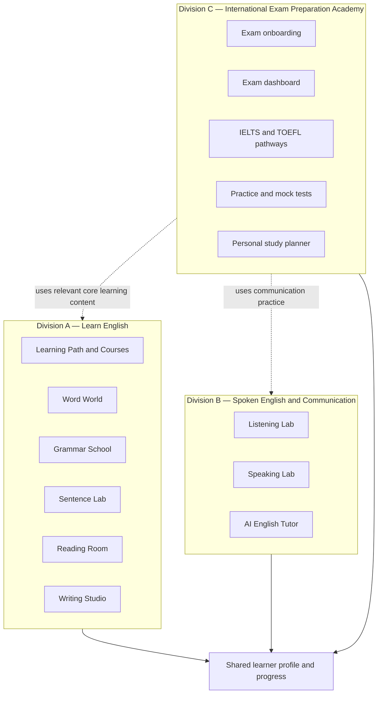
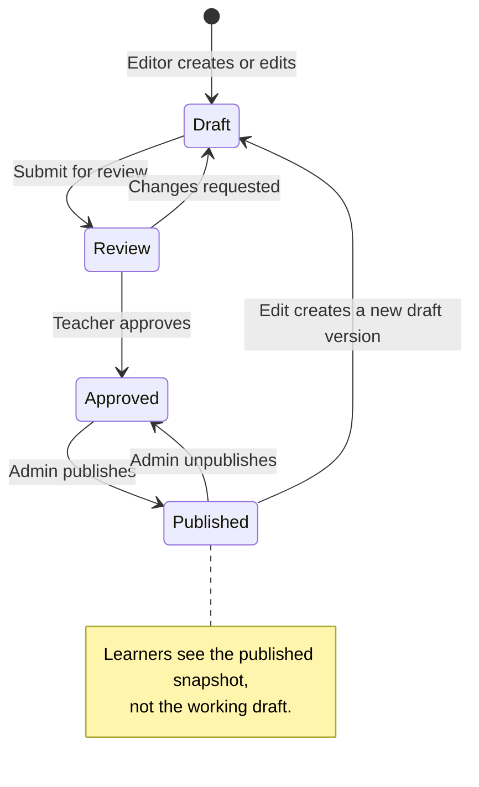
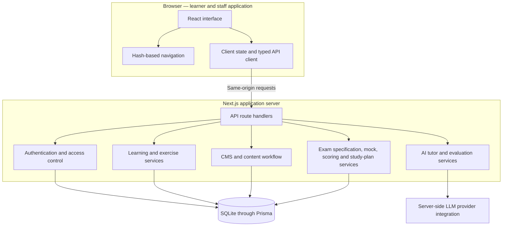

# TalkSy — Learn. Practice. Speak. Excel.

*From Your First English Word to Confident Communication.*

TalkSy is an English-learning and international examination-preparation platform designed to take learners from their first English words to confident communication and structured preparation for IELTS and TOEFL iBT.

The platform brings together three connected learning experiences:

- **Learn English:** a progressive core curriculum, structured courses, grammar, vocabulary, sentence construction, reading, and writing.
- **Spoken English & Communication:** listening and speaking practice, pronunciation activities, conversation scenarios, and an AI English tutor.
- **International Exam Preparation Academy:** separate IELTS and TOEFL iBT learning pathways, practice activities, timed mock examinations, scoring guidance, and study planning.

TalkSy is intended to be more than a collection of attractive course pages. Its educational experience is built around explanations, worked examples, guided practice, independent exercises, meaningful feedback, revision, and measurable learning progress.

> **Implementation snapshot:** The supplied project README records a successful production build, 502 passing unit/route tests, 973 browser E2E checks in the regression suite, and 79/79 staging smoke checks as of 13 November 2026. These are historical project-reported results, not a fresh test run performed while preparing this document. See [Quality Assurance](#quality-assurance) and [Known Limitations](#known-limitations) for context.

> **Brand note:** The supplied project README uses both “EnglishPath” and “TalkSy”, explaining that EnglishPath appears in some product documentation while TalkSy remains in the application shell and internal identifiers. This README adopts **TalkSy** as the canonical project name, consistent with the TalkSy product identity. Audit and reconcile remaining user-facing brand strings in the application before release.

---

## Contents

- [Vision and Learning Philosophy](#vision-and-learning-philosophy)
- [The Three Divisions](#the-three-divisions)
- [Division A — Learn English](#division-a--learn-english)
- [Division B — Spoken English and Communication](#division-b--spoken-english-and-communication)
- [Division C — International Exam Preparation Academy](#division-c--international-exam-preparation-academy)
- [Shared Learner Experience](#shared-learner-experience)
- [AI English Tutor](#ai-english-tutor)
- [Educational Content Standards](#educational-content-standards)
- [Assessment, Scoring, and Content Integrity](#assessment-scoring-and-content-integrity)
- [Admin CMS and Content Governance](#admin-cms-and-content-governance)
- [Architecture](#architecture)
- [Technology and Project Structure](#technology-and-project-structure)
- [Navigation and Routes](#navigation-and-routes)
- [Getting Started](#getting-started)
- [Configuration](#configuration)
- [Testing and Development Workflow](#testing-and-development-workflow)
- [Deployment and Operations](#deployment-and-operations)
- [Security and Privacy](#security-and-privacy)
- [Accessibility, Responsiveness, and Design](#accessibility-responsiveness-and-design)
- [Current Implementation Snapshot](#current-implementation-snapshot)
- [Known Limitations](#known-limitations)
- [Roadmap](#roadmap)
- [Contributing](#contributing)
- [Educational and Trademark Disclaimer](#educational-and-trademark-disclaimer)
- [License](#license)
- [Maintainer](#maintainer)

---

## Vision and Learning Philosophy

TalkSy is organised around three connected stages of language development:

1. **Acquire English:** build grammar, vocabulary, sentence skills, and the foundations of the four language skills.
2. **Use English:** develop listening comprehension, speaking confidence, pronunciation, writing ability, and practical communication.
3. **Demonstrate proficiency:** prepare for recognised examinations through test-specific study, deliberate practice, timed assessments, and performance review.

Each stage has its own learning environment and feedback approach, but learners should have one account, a connected learning history, and a shared progress record. The examination academy should reuse relevant general-English material rather than duplicate it. For example, a learner who struggles with sentence construction in IELTS Writing should be directed to the appropriate grammar and sentence-building lessons.

### Core principles

- **Progressive learning:** teach foundations before advanced concepts.
- **Understand before memorising:** explain why a rule works and how it is used.
- **Practice with purpose:** connect every important lesson to meaningful exercises.
- **Feedback that teaches:** explain errors and show learners how to improve.
- **Evidence-based progress:** measure demonstrated learning, not page views.
- **Practical communication:** connect classroom concepts to everyday, academic, and professional English.
- **Honest assessment:** distinguish measured results, AI suggestions, and unofficial score estimates.

## The Three Divisions

| Division | Name | Main purpose | Main environments |
|---|---|---|---|
| **A** | Learn English | Build general English knowledge and core language skills | Learning Path, Courses, Word World, Grammar School, Sentence Lab, Reading Room, Writing Studio |
| **B** | Spoken English & Communication | Develop listening, speaking, pronunciation, and conversational ability | Listening Lab, Speaking Lab, AI English Tutor |
| **C** | International Exam Preparation Academy | Prepare for IELTS and TOEFL iBT through test-specific learning and practice | Exam onboarding, learner dashboard, exam pathways, practice banks, mock library, timed test player, study planner |



The three divisions are separate experiences, not separate products. Learners should be able to move from a test-preparation recommendation to the relevant foundational lesson without losing their place in the academy.

---

## Division A — Learn English

### General English pathway: Pre-A1 to C1

The general English programme is intended to progress from absolute beginner foundations to advanced communication. The exact live curriculum should be read from the curriculum source and CMS rather than inferred from this overview.

| Level | Learning focus |
|---|---|
| Pre-A1 | Alphabet, basic sounds, greetings, essential words, introductions, and simple expressions |
| A1 | Everyday vocabulary, basic sentence patterns, be-verbs, simple questions, and familiar situations |
| A2 | Common tenses, everyday conversations, descriptions, short texts, and practical writing |
| B1 | Connected speech, paragraph writing, broader vocabulary, reading strategies, and independent communication |
| B2 | Complex grammar, discussion, extended writing, comprehension, and academic or workplace communication |
| C1 | Nuanced vocabulary, advanced grammatical control, argumentation, fluent communication, and complex texts |

### Learning Path and Courses

The learning path gives learners an ordered route through the core curriculum. CMS-authored courses provide an additional way to organise content into levels, modules, units, and lessons, including prerequisites and enrolment.

Expected learner capabilities include:

- Browse available learning paths and courses.
- Open lessons in the appropriate sequence.
- Review lesson objectives and prerequisite knowledge.
- Complete lesson sections and assessments.
- Continue from the last relevant learning point.
- Track completion and assessment history.
- Access published course content rather than unfinished editorial drafts.

### Word World — Vocabulary Development

Word World helps learners understand and retain English vocabulary through context and revision.

Its documented capabilities include:

- Vocabulary organised into categories.
- Word meanings and usage notes.
- Example sentences and contextual usage.
- Synonyms, antonyms, relationships, and word families where supplied.
- Flashcard and challenge-style practice.
- Personal vocabulary lists.
- Spaced-repetition-style review to revisit words over time.

Vocabulary should be taught through meaning and usage, not memorisation alone. Optional Urdu meanings may be used as a learner-support feature where available; English explanations and examples remain central to the learning process.

### Grammar School and Error Clinic

Grammar School provides structured explanations and grammar reference material. Its documented areas include parts of speech and a tense explorer.

The Error Clinic is intended to help learners submit sentences, identify likely grammar problems, understand corrections, and navigate to relevant lessons. Corrections should explain the underlying rule rather than merely replace the learner's sentence.

Core subject areas include:

- Nouns, pronouns, verbs, adjectives, adverbs, and other parts of speech.
- Subject, verb, object, and sentence components.
- Be-verbs, auxiliary verbs, and modal verbs.
- Tenses and verb forms.
- Articles, determiners, prepositions, and conjunctions.
- Affirmative, negative, and interrogative sentence structures.
- Active and passive voice.
- Direct and indirect speech.
- Phrases, clauses, and conditionals.
- Subject–verb agreement, punctuation, and common errors.

### Sentence Lab

Sentence Lab focuses on the construction and analysis of English sentences. It is intended to help learners understand word order, sentence patterns, and the relationship between sentence components through guided and timed activities.

### Reading Room

Reading Room offers level-appropriate texts and comprehension practice. Learning activities may cover:

- Main idea and supporting details.
- Finding specific information.
- Skimming and scanning.
- Vocabulary from context.
- Inference, purpose, tone, and attitude.
- Understanding paragraph structure and relationships between ideas.

### Writing Studio

Writing Studio supports progressive writing development, from sentence-level work to longer pieces. Its documented workflow includes assignment-based practice, drafts, autosave, feedback dimensions, and revision comparison.

Writing activities may include:

- Correct sentence construction.
- Paragraph organisation and cohesion.
- Descriptive, narrative, explanatory, and argumentative writing.
- Emails, letters, applications, reports, and essays.
- Editing, proofreading, grammar, and clarity.

---

## Division B — Spoken English and Communication

### Listening Lab

Listening Lab develops the ability to understand spoken English in progressively more demanding contexts. Activities should help learners recognise words, identify key information, follow conversations, and understand longer spoken material.

Useful learning elements include audio playback, question practice, transcripts where appropriate, comprehension feedback, and repeated practice. Audio playback rules should match the activity's learning or assessment purpose.

### Speaking Lab

Speaking Lab helps learners practise producing spoken English rather than only reading about it. The documented product scope includes guided activities, conversation scenarios, and pronunciation items.

Potential learning activities include:

- Guided speaking prompts.
- Everyday conversation practice.
- Role-play and situational dialogues.
- Pronunciation and word-stress practice.
- Recording and playback where supported by the browser and permission settings.
- Fluency and response-organisation practice.
- Structured feedback and improvement suggestions.

Microphone access should only be requested when a learner starts a feature that requires it. The interface should explain why permission is needed. Recording and transcript retention must follow the platform's privacy controls.

### Practical Communication

The spoken-English experience should connect grammar and vocabulary to real communication, including introductions, asking for information, explaining ideas, expressing opinions, participating in discussions, interviews, and academic or workplace situations.

---

## Division C — International Exam Preparation Academy

The International Exam Preparation Academy is a separate, test-focused environment for IELTS and TOEFL iBT candidates. Each examination must retain its own task structures, timing rules, scoring logic, question types, mock configurations, and assessment rubrics.

The academy should be treated as an evolving examination product. Test specifications must be maintained as versioned data and reviewed against official provider information when formats or policies change.

### IELTS Preparation

The academy supports separate pathways for:

- IELTS Academic.
- IELTS General Training.
- IELTS for UKVI guidance, where relevant to the learner's intended test and application.

IELTS Academic and General Training share Listening and Speaking preparation where appropriate, but their Reading and Writing preparation must remain distinct.

| Skill | Preparation coverage |
|---|---|
| Listening | Four-part test structure, supported question types, note completion, multiple choice, matching, maps, and listening strategies |
| Academic Reading | Passage analysis, question types, skimming, scanning, inference, vocabulary in context, and time management |
| General Training Reading | Everyday and workplace texts, longer passages, question types, and targeted reading strategies |
| Academic Writing Task 1 | Charts, tables, graphs, maps, processes, comparisons, overviews, and data description |
| Writing Task 2 | Essay planning, argument development, paragraphing, coherence, vocabulary, grammar, and common essay approaches |
| General Training Writing Task 1 | Formal, semi-formal, and informal letters, purpose, tone, organisation, and model responses |
| Speaking | Parts 1, 2, and 3; familiar topics, cue cards, extended answers, discussion, fluency, and pronunciation |

IELTS preparation material should provide:

- Explanations of the test structure and task requirements.
- Skill-specific learning pathways.
- Original practice passages, prompts, recordings, and questions.
- Step-by-step methods for supported question types.
- Worked examples and model answers with detailed analysis.
- Timed skill and section practice.
- Full mock-test experiences where published tests are available.
- Objective answer keys with explanations.
- Writing and speaking feedback aligned with publicly available IELTS assessment criteria.
- Personalised preparation plans based on the learner's current performance and target band.

#### IELTS writing and speaking assessment dimensions

Writing feedback should explain the public assessment dimensions:

- Task Achievement or Task Response.
- Coherence and Cohesion.
- Lexical Resource.
- Grammatical Range and Accuracy.

Speaking feedback should explain:

- Fluency and Coherence.
- Lexical Resource.
- Grammatical Range and Accuracy.
- Pronunciation.

The feedback should identify strengths, weaknesses, and practical next steps. It must not imply that an AI-generated estimate is an official examiner result.

### TOEFL iBT Preparation

The TOEFL Academy must follow the test format applicable on the date of the learner's examination. The supplied project specification records the TOEFL iBT format effective **21 January 2026**. The relevant task families are:

| Section | Task types in the documented 2026 format |
|---|---|
| Reading | Complete the Words; Read in Daily Life; Read an Academic Passage |
| Listening | Listen and Choose a Response; Listen to a Conversation; Listen to an Announcement; Listen to an Academic Talk |
| Writing | Build a Sentence; Write an Email; Write for an Academic Discussion |
| Speaking | Listen and Repeat; Take an Interview |

TOEFL preparation material should provide:

- An explanation of what each task measures.
- Task instructions and expected response formats.
- Worked examples and task-specific solving methods.
- Original practice questions and detailed explanations where applicable.
- Timing guidance and practice strategies.
- Skill-specific revision material.
- Timed section practice and mock examinations aligned with the active specification.
- Performance reports and personalised recommendations.

Reading and Listening adaptive behaviour, scoring, timing, and any score-comparison guidance must be implemented from the active versioned specification and checked against current ETS guidance. Do not reuse obsolete TOEFL task formats merely because they appear in older preparation material.

### Exam Onboarding and Learner Dashboard

The documented onboarding flow collects a learner's preparation goal, such as:

- Examination and variant.
- Self-reported proficiency.
- Target score or band.
- Planned examination date.
- Available study time per day.
- Sections the learner finds most difficult.

The exam dashboard should bring together section estimates, strengths and weaknesses, pathways, practice recommendations, mock history, and the study plan. Estimates should be based on declared evidence and should be labelled honestly.

### Exam Pathways and the Learning Bridge

The academy should direct learners to relevant general-English or communication resources when a weakness is foundational. Examples:

- Weak sentence construction in IELTS Writing → Grammar School and Sentence Lab.
- Weak academic vocabulary in TOEFL Reading → Word World.
- Weak listening comprehension → Listening Lab.
- Weak spoken response organisation → Speaking Lab and the AI Tutor.

This bridge prevents the academy from duplicating the core curriculum and gives learners a route to repair underlying skill gaps.

### Practice Modes and Mock Tests

The documented mock engine supports a range of exam practice modes, including:

1. Full mock examination.
2. Section-wise practice.
3. Timed practice with a learner-selected time budget.
4. Untimed learning practice with feedback.
5. Previous-mistakes practice.
6. Custom practice filtered by section, task type, and difficulty.

The player should follow the active examination specification for section timing, navigation, review flags, audio replay, and other test rules. Untimed learning practice should be clearly distinguished from an exam-condition attempt.

A mock-test experience should support:

- Clear instructions before a test begins.
- Section timers and remaining-time indicators.
- Appropriate question navigation.
- Saving answers and resuming an in-progress attempt where supported.
- Submission confirmation.
- Objective scoring for automatically gradable questions.
- Constructed-response evaluation or an explicit awaiting-review status.
- Result summaries, answer review, explanations, and next-step recommendations.
- Historical attempts and meaningful comparisons.

### Personalised Study Planner

The study planner should convert a learner's target, available time, exam date, baseline diagnostic, and practice evidence into a realistic preparation schedule. It should give more attention to weaker sections and adjust recommendations when later practice shows repeated difficulties.

Readiness labels should describe evidence and uncertainty. A readiness label is not a promise of a particular result.

---

## Shared Learner Experience

The general-English programme, communication labs, and examination academy should share a consistent learner profile and progress model.

The documented product scope includes:

- Learning progress and completed activities.
- Practice attempts and assessment history.
- Skill profiles and revision recommendations.
- Bookmarks and saved learning resources.
- Vocabulary lists and review history.
- Personal goals and achievements.
- Study plans and examination goals.
- Relevant learning reminders.

Progress must reflect actual learner activity. Opening a page must not count as mastering a lesson. Missing a day should not erase completed learning or punish the learner by resetting genuine progress.

---

## AI English Tutor

The AI English Tutor is intended to act as a context-aware learning assistant across the core curriculum and examination academy.

Its documented and planned educational roles include:

- Explaining grammar concepts in simple, level-appropriate language.
- Defining unfamiliar words, expressions, and phrases.
- Providing contextual examples.
- Correcting learner-written sentences and explaining the corrections.
- Supporting writing revision.
- Guiding speaking and conversation practice.
- Generating additional exercises for a specific topic.
- Giving hints before revealing answers when appropriate.
- Explaining why an answer is incorrect.
- Supporting IELTS and TOEFL task practice with exam-specific guidance.

### AI quality and reliability

- Tutor responses should use the relevant lesson, learner level, and task context where available.
- AI suggestions must be clearly distinguished from deterministic grading results.
- Uncertain explanations must not be presented as verified facts.
- AI-generated writing and speaking scores must be labelled as estimates or practice feedback.
- Low-confidence or unavailable evaluations should return an explicit pending or review state rather than an invented score.
- Provider errors, timeouts, and usage limits must not destroy learner submissions.
- API credentials and model configuration must remain server-side.

The application uses a provider-agnostic LLM seam so that AI consumers do not need to depend directly on a particular provider SDK. The supplied project documentation identifies the Z-AI SDK as the current integration.

---

## Educational Content Standards

TalkSy must remain a real learning platform, not a collection of visually attractive but empty pages. Placeholder descriptions, repeated filler, unsupported claims, and exercises without reliable answers must not be presented as complete educational material.

### Recommended lesson structure

A substantial lesson should include, where relevant:

1. Lesson title and introduction.
2. Learning objectives.
3. Prerequisite knowledge.
4. Detailed explanation in level-appropriate language.
5. Rules, patterns, and important distinctions.
6. Step-by-step worked examples.
7. Everyday, academic, or professional usage.
8. Common mistakes and corrected examples.
9. Guided practice.
10. Independent exercises.
11. Correct answers and explanations.
12. Lesson summary and revision points.
13. Homework or further practice.
14. Links to related lessons.

### Examination lesson structure

Each IELTS or TOEFL lesson should also explain:

- What the task tests.
- How the task is presented.
- What the learner must do.
- Step-by-step solving strategies.
- Time-management considerations.
- Common mistakes.
- Worked examples and model responses where relevant.
- Applicable public assessment criteria.
- Practice tasks with validated answers or evaluation guidance.
- Further improvement strategies.

### Content governance rules

- Teach prerequisites before advanced concepts.
- Use original or appropriately licensed examples and practice materials.
- Validate answer keys with the real grading engine before publication.
- Do not inflate question-bank totals with duplicate or meaningless items.
- Label draft, reviewed, approved, and published content accurately.
- Review examination-specific content against official sources.
- Keep content and assessment data separate from presentation components.

---

## Assessment, Scoring, and Content Integrity

The platform's assessment design follows several important rules.

### Server-side grading

Answer keys and grading logic must remain on the server. Exercise and mock-test payloads sent to the browser must contain only the information required to display and answer the question. They must not expose answer keys, grading keywords, hidden model answers, or pre-submission feedback.

### Deterministic and AI feedback are separate

Objective answer checking and score arithmetic should be deterministic wherever possible. AI-generated suggestions or evaluations must be labelled separately and should include an appropriate disclaimer.

### Version-pinned examination attempts

Every mock attempt should retain the examination specification version used when the attempt was created. If an examination format changes, old attempts remain interpretable and must not silently be re-graded using a newer specification.

### Honest estimates

- IELTS and TOEFL practice results are not official results.
- Score conversion tables used for practice should be labelled approximate where appropriate.
- Constructed responses that cannot be reliably evaluated should remain pending review rather than receive fabricated scores.
- Unknown or unavailable values should be displayed as unavailable, not guessed.

### Content snapshots

Learners should see published CMS snapshots rather than unfinished working drafts. Historical assessments should retain the content version against which they were graded.

---

## Admin CMS and Content Governance

The staff-facing CMS provides a controlled workflow for creating, reviewing, approving, and publishing educational content.

### Roles

The documented role hierarchy is:

| Role | Main responsibility |
|---|---|
| Student | Access published learning content and personal learning records |
| Editor | Create and edit drafts; submit content for review |
| Teacher | Review submissions; approve or request changes |
| Admin | Publish and unpublish content; manage users and platform configuration |

Role checks must be enforced on the server for every protected operation. Hiding an admin control in the browser is not an authorisation mechanism.

### Content lifecycle



### Documented CMS capabilities

- Course, module, unit, lesson, and lesson-block authoring.
- Question bank authoring across supported exercise types.
- Review workflow and version history.
- Audio and image asset management with validation metadata.
- Course import and export with validation and preview.
- User and role management.
- Aggregate learning analytics.
- Append-only audit trail for workflow actions.
- Examination specification management.
- Mock-test publishing and archiving.

The CMS should not expose password hashes or private learner content to staff who do not need access to it. Analytics should use appropriate aggregates and access controls.

---

## Architecture

TalkSy is documented as a single Next.js application with a single public application entry point and hash-based navigation for the learner-facing single-page experience. Server route handlers provide the API layer, Prisma provides database access, and SQLite is the documented local and bundled demonstration database.



### Main architecture boundaries

| Layer | Responsibility |
|---|---|
| Browser application | Navigation, learner dashboard, lesson player, labs, examination interfaces, admin interface |
| API route handlers | Validated requests, authentication, authorisation, and application operations |
| Learning services | Exercise delivery, grading, progress, vocabulary, reading, listening, speaking, and writing |
| CMS services | Role checks, content workflow, versioning, publishing, import/export, and audit history |
| Examination services | Versioned specifications, pathways, mock tests, scoring, evaluation, diagnostics, and planning |
| Data layer | Users, sessions, learning activity, CMS content, examination data, and audit records |
| AI integration | Provider-independent access to tutoring and assisted evaluation |

### Data model

The Prisma schema groups data into three broad domains:

1. **Accounts and security:** users, sessions, authentication throttling, and password-reset tokens.
2. **Learner activity:** progress, notes, attempts, spaced-repetition records, bookmarks, vocabulary lists, skill activity, tutor conversations, goals, achievements, and certificates.
3. **CMS and examination academy:** content structures, lesson versions, prerequisites, questions, assets, enrolments, examination specifications, rubrics, pathways, mock tests, attempts, responses, and evaluations.

The exact number of Prisma models and API route handlers is intentionally not repeated here because the supplied README contains conflicting counts for those inventories. Use the schema and the repository's fact-generation script as the source of truth when reporting exact totals.

### Examination data relationships

The examination domain connects learner profiles and goals to versioned specifications, pathways, mock tests, attempts, responses, and evaluations. A mock test is associated with a specification; an attempt retains the specification version used for that test. This is essential for preserving the meaning of historical results when an examination provider changes its format.

### Validation and database access

- Prisma ORM is the documented data-access layer.
- Structured JSON fields and enum-like values should be parsed and validated through shared schemas.
- Avoid ad-hoc string SQL in application services.
- Preserve database constraints and referential integrity.
- Keep answer keys and grading data in server-only projections.

---

## Technology and Project Structure

The supplied project documentation identifies the following technology and implementation choices. Check `package.json`, the lockfile, configuration files, and source tree for the exact versions currently installed.

| Area | Technology / approach |
|---|---|
| Application framework | Next.js |
| UI | React 19 and TypeScript |
| Component system | shadcn/ui-based primitives and feature components |
| Client state | Zustand and a typed API client |
| Routing | Hash-based learner navigation under the public `/` route |
| Database | SQLite |
| ORM | Prisma |
| Input validation | Zod schemas in shared service boundaries |
| AI integration | Z-AI SDK behind a provider-agnostic server-side LLM interface |
| Speech features | Browser speech capabilities and related recording/transcription services where enabled |
| Testing | Bun test runner and browser E2E scripts using `agent-browser` |
| Package/runtime tooling | Bun; Node.js is also documented as an alternative runtime for supported environments |

### Project structure

The following is a logical guide to the documented repository. Confirm exact file names and directories in the current checkout before editing them.

```text
.
├── prisma/
│   └── schema.prisma             # Relational data model
├── docs/
│   ├── PRD.md                    # Product requirements
│   ├── EXAM_ACADEMY.md           # IELTS and TOEFL academy specification
│   ├── DEPLOYMENT.md             # Deployment, backup and recovery guide
│   ├── ENGINE.md                 # Learning and exercise engine
│   └── ...                       # Feature specifications and ADRs
├── scripts/
│   ├── readme-facts.ts           # Repository inventory / README fact sheet
│   ├── restore-seed-db.ts        # Restore seed database where applicable
│   ├── staging-smoke-exams.sh    # Exam-academy staging smoke tests
│   ├── staging-smoke-vercel.sh   # Deployment and security smoke tests
│   └── e2e*.sh                   # Browser end-to-end suites
├── src/
│   ├── app/
│   │   ├── page.tsx              # Public application entry point
│   │   └── api/                  # API route handlers
│   ├── components/
│   │   ├── ui/                   # Reusable UI primitives
│   │   └── app/                  # Learner, CMS and exam feature components
│   ├── data/                     # Typed content-as-code modules
│   ├── hooks/                    # Routing, speech and recording hooks
│   └── lib/
│       ├── auth/                 # Authentication and security services
│       ├── engine/               # Exercise delivery, grading and progress
│       ├── cms/                  # CMS workflow and access control
│       ├── exams/                # Specs, scoring, mocks, diagnostics and plans
│       ├── llm/                  # Provider-independent AI integration
│       └── ...                   # Skill and learner services
├── db/
│   ├── custom.db                 # Local/deployment seed database, if supplied
│   └── media/                    # Media assets, if supplied
├── worklog.md                   # Development handover, if maintained in repo
└── README.md
```

The operational handover path used by the development workflow is `/home/z/my-project/worklog.md`. It may be outside the Git repository depending on the environment.

---

## Navigation and Routes

The documented learner application uses hash-based navigation under `/`. The following routes are recorded in the supplied project README; verify the current route table in the hash-router implementation if it changes.

| Route | Environment |
|---|---|
| `#/` | Home |
| `#/login`, `#/register`, `#/reset/<token>` | Authentication and password reset |
| `#/library`, `#/lesson/<slug>` | Learning path and lesson player |
| `#/courses`, `#/course/<slug>`, `#/course-lesson/<slug>` | CMS-authored courses |
| `#/vocabulary/<tab>` | Word World |
| `#/grammar`, `#/grammar/tenses`, `#/grammar/clinic` | Grammar School and Error Clinic |
| `#/lab` | Sentence Lab |
| `#/reading/<slug>` | Reading Room |
| `#/listening/<slug>` | Listening Lab |
| `#/speaking`, `#/speaking/activity/<slug>`, `#/speaking/conversation/<slug>` | Speaking Lab |
| `#/writing`, `#/writing/a/<slug>` | Writing Studio |
| `#/tutor`, `#/tutor/c/<id>`, `#/tutor/lesson/<ref>` | AI English Tutor |
| `#/progress/<tab>` | My Progress |
| `#/exams` and `#/exams/*` | International Exam Preparation Academy |
| `#/admin` | Admin CMS |

---

## Getting Started

### Prerequisites

The supplied project documentation records these requirements:

- Bun 1.1+ (recommended), or a supported Node.js 20+ environment.
- Git.
- A modern browser.
- A writable SQLite database location for local development.
- Microphone permissions for speaking or recording activities that use them.
- Server-side AI provider configuration for live AI features, where enabled.

### Clone the repository

```bash
git clone <repository-url>
cd <project-directory>
```

### Install dependencies

```bash
bun install
```

### Initialise the local database

```bash
bun run db:push
```

This command is documented for local schema setup. For production, use the migration and deployment process in `docs/DEPLOYMENT.md`; do not use a development schema-push command as a substitute for a reviewed production migration process.

### Start the development server

```bash
bun run dev
```

Open the local address printed by the development server (the documented default is `http://localhost:3000`).

### Demo learner

The supplied project README documents a demo learner account as:

```text
Email:    demo@talksy.app
Password: demo1234
```

Treat these credentials as demonstration-only. Do not use them for a real account or production administration. Confirm that the demo user is enabled in the database currently being used. Seeded staff accounts must change their initial passwords before performing protected CMS or examination-administration actions.

---

## Configuration

### Database

`DATABASE_URL` is documented as optional for local development. When it is not set, the application defaults to the repository's `db/custom.db` SQLite file. Confirm the current database resolver in `src/lib/db.ts` before changing runtime configuration.

Tests are documented to use a separate `db/test.db` database through `bun run test`. Do not run test commands in a way that points at the development or seed database.

### AI provider

AI credentials are held in server-side SDK configuration and must never be exposed to browser code. The application is designed to route tutor and evaluation requests through the provider-independent LLM interface.

### Environment-file guidance

The supplied project audit states that the repository does not contain an `.env.example` file and that `DATABASE_URL` is the only documented optional environment variable. Do not assume that `cp .env.example .env` works. Check the actual configuration files before adding environment variables, and create a sanitised example file only when the project needs one.

Never commit:

- API keys or provider credentials.
- Production database URLs or passwords.
- Session or signing secrets.
- Real learner data or private uploaded content.

---

## Testing and Development Workflow

### Standard quality gates

Run the checks supported by the repository:

```bash
bunx tsc --noEmit
bun run lint
bun run test
bun run build
```

The project documentation specifically warns that tests must be run through `bun run test`, which points to `db/test.db`. A bare `bun test` may bypass the intended database setup and is guarded against in the documented database layer. Do not remove or bypass that safeguard.

### Browser E2E tests

Start the application and inspect the available browser automation commands before testing:

```bash
agent-browser --help
```

The supplied project documents browser suites under `scripts/e2e*.sh`. These cover learner flows, the CMS, examination administration, mock-test behaviour, AI evaluation, and study planning. Run the affected suite after changing a feature, and run the broader regression set before release where practical.

### Staging smoke tests

```bash
bun run build
bash scripts/staging-smoke-exams.sh
bash scripts/staging-smoke-vercel.sh
```

These scripts are documented as staging checks for the examination academy, deployment simulation, and security-related flows. Confirm their prerequisites and current implementation before running them.

### AI reliability checks

```bash
bun scripts/ai-reliability.ts
```

This check depends on the configured AI provider and should be reported as blocked—not passed—when credentials or provider access are unavailable.

### Development-cycle workflow

Every significant development cycle should:

1. Read `/home/z/my-project/worklog.md` before making changes.
2. Inspect the actual repository and compare it with the handover document.
3. Run the relevant existing tests and browser QA before substantial development.
4. Prioritise build failures, runtime problems, data-integrity issues, broken learner journeys, and security issues.
5. Implement the most valuable next improvement using the existing architecture.
6. Add or update tests for the changed behaviour.
7. Run type checks, lint, tests, and production build.
8. Verify the affected user journey with `agent-browser`.
9. Update the worklog with completed work, test evidence, unresolved issues, and next priorities.

A test must be reported as passed only if it was actually run successfully. If a check could not be executed, record why.

---

## Deployment and Operations

The supplied deployment notes describe three operating modes.

### Local development

- Run the Next.js development server with `bun run dev`.
- Use the local SQLite database, documented as `db/custom.db` by default.
- Use the isolated test database for automated tests.

### Self-hosted production

The documented production process is based on a production build, database migration deployment, and running the application behind a TLS-enabled reverse proxy.

Operational considerations:

- SQLite is a single-writer database and is suitable only for deployments whose concurrency and durability needs fit that model.
- Enable secure cookies when running behind HTTPS.
- Back up the database and media assets.
- Test restoration, not just backup creation.
- Follow the deployment guide's application, database, and content rollback procedures.
- Consider a hosted relational database such as PostgreSQL when a durable multi-instance deployment or higher write concurrency is required. The datasource migration must be implemented and tested; changing a URL alone may not be sufficient.

### Serverless demonstration mode

The supplied project documentation describes a Vercel-compatible demonstration mode that copies the bundled SQLite seed database to a writable temporary directory for each function instance.

Important limitations:

- Data written in this mode is ephemeral.
- Function instances do not share their temporary database state.
- Data may reset when instances recycle.
- This mode is suitable for a demonstration, not durable learner records.
- Durable production use requires a shared persistent database and an appropriate migration/deployment design.

The project README's 13 November 2026 snapshot reports that the public demo at `https://talksy-peach.vercel.app` was still running a pre-exam-academy build: `GET /api` returned 200, while `GET /api/exams/overview` returned 404. Check the deployed build before presenting the public demo as a complete demonstration of Division C.

### Operational health

The documented health endpoint is:

```text
GET /api
```

It returns basic service health information, including uptime and timestamp. The supplied audit identifies structured logging, metrics export, and centralised error tracking as areas for improvement.

---

## Security and Privacy

TalkSy may process account information, learning history, written submissions, microphone input, transcripts, and AI conversation content. These data require appropriate access controls, retention rules, and user-facing transparency.

### Documented security controls

The supplied project README records the following controls:

- Passwords hashed with `scrypt`.
- Database-backed opaque session tokens with expiry and suspension checks.
- Login throttling by account and IP address.
- Registration and password-reset rate limits.
- Single-use password-reset tokens stored as SHA-256 hashes with a limited lifetime.
- Session revocation after successful password reset.
- A first-login password-change gate for seeded staff accounts.
- Server-side role-based access control for CMS and examination administration.
- Ownership checks for learner-specific routes and records.
- Server-side stripping of answer keys and grading data from client payloads.
- File upload size and MIME-type restrictions.
- User-level controls for deleting tutor conversations and managing transcript retention.

### Privacy expectations

- Collect only information needed for a clear product purpose.
- Explain microphone and recording use before requesting permission.
- Do not store speaking recordings unless a clearly disclosed feature requires it.
- Apply configured retention periods to transcripts and allow deletion where supported.
- Protect learner notes, submissions, progress, and tutor conversations from other users.
- Avoid placing secrets, personal information, or complete learner submissions in logs.
- Clearly disclose when content is sent to an AI provider.
- Apply appropriate rate limits and abuse controls to public API routes.
- Validate uploaded files and avoid trusting client-supplied metadata without server-side checks.

### Security items requiring continued review

The supplied audit also lists low/informational findings and operational gaps that should remain on the security backlog, including CSRF protections, secure-cookie deployment configuration, session-token storage hardening, upload content-type validation, access scope for uploaded media, and email delivery for password reset. Reassess these findings against the current code and deployment before treating them as resolved.

---

## Accessibility, Responsiveness, and Design

TalkSy's interface should be polished, calm, welcoming, and focused on learning. Visual design should help learners understand where they are, what they should do next, and how they are progressing.

### Brand palette

| Token | Role | Hex |
|---|---|---|
| Navy | Primary dark foundation | `#0B1F46` |
| Blue | Primary action and navigation | `#1E88E5` |
| Cyan | Supporting accent | `#06B6D4` |
| Orange | Highlight and emphasis | `#FF8A00` |
| Gold | Secondary highlight | `#FFC247` |

### Design principles

- Establish a clear type scale and information hierarchy.
- Use consistent spacing, alignment, borders, and surface treatments.
- Maintain accessible contrast in both light and dark themes.
- Use responsive layouts across mobile, tablet, and desktop.
- Provide visible hover, focus, active, disabled, loading, success, and error states.
- Keep lesson pages focused and reduce unnecessary distractions.
- Use motion to communicate state or provide feedback, not as decoration alone.
- Respect `prefers-reduced-motion`.
- Use semantic structure, keyboard navigation, accessible labels, and descriptive validation errors.
- Provide text alternatives for meaningful audio and visual learning material where appropriate.

The supplied project audit records keyboard navigation, landmarks, contrast, reduced-motion, and responsive checks, while also noting that screen-reader field testing with NVDA, JAWS, or VoiceOver had not been completed at that time.

---

## Current Implementation Snapshot

This section summarises the implementation described in the supplied project README. It is not a substitute for inspecting the current source code or deployment.

### Documented learner environments

| Environment | Documented implementation |
|---|---|
| Learning Path | Content-as-code curriculum with lesson blocks and server-graded exercises |
| Courses | CMS-authored courses with levels, modules, units, lessons, prerequisites, and enrolments |
| Word World | Vocabulary categories, flashcards, challenges, personal lists, and spaced-repetition-style review |
| Grammar School | Grammar learning modules, tense reference, and Error Clinic |
| Sentence Lab | Structured sentence-building practice and timed challenges |
| Reading Room | Levelled texts, glossaries, comprehension questions, and progress tracking |
| Listening Lab | Listening activities from word recognition through dialogue comprehension |
| Speaking Lab | Guided speaking activities, conversation scenarios, and pronunciation practice |
| Writing Studio | Progressive writing assignments, drafts, autosave, feedback, and revision comparison |
| AI Tutor | Context-aware tutoring modes and conversation support |
| My Progress | Learner analytics, skill profiles, revision, goals, achievements, and certificates |
| Exam Academy | Onboarding, dashboard, separate exam pathways, mock library, timed player, and study planning |

### Documented examination specifications

The supplied README records three active, versioned specifications in the seed database:

- IELTS Academic v2.
- IELTS General Training v2.
- TOEFL iBT 2026-format v1.

It also records official source references and review dates in specification data. The supplied notes state that IELTS v2 specifications were introduced with an effective date of 1 July 2026 and that the previous version was retired as history. Re-check official provider guidance before relying on these details for a future examination date.

### Documented QA snapshot

| Quality area | Result recorded in the supplied project README | Date / qualification |
|---|---:|---|
| Unit and route tests | 502 passed, 0 failed | Re-run recorded on 13 November 2026 |
| Browser E2E suite inventory | 973 checks across 12 suites | Some suites re-run on 13 November; remaining suites referenced from the delivery audit |
| Exam-academy staging smoke | 65/65 | Re-run recorded on 12 November 2026 under a Vercel-style simulation |
| Deployment and security smoke | 14/14 | Re-run recorded on 12 November 2026 |
| Combined staging smoke | 79/79 | 65 exam checks + 14 deployment/security checks |
| Production build | Successful | Re-verified on 12 November 2026 |
| Live AI reliability | 5/5 | Recorded in the delivery audit; not described as re-run on 13 November |

Reproduce the checks using the commands in [Testing and Development Workflow](#testing-and-development-workflow). Do not treat these historical results as proof that the current checkout or latest deployment is still passing.

### Inventory-count note

The supplied README contains conflicting counts for API route handlers, Prisma models, some skill-content inventories, mock tests, pathways, and component totals. To avoid publishing incorrect numbers, this consolidated README describes the capabilities without repeating those disputed totals. Where available, run:

```bash
bun scripts/readme-facts.ts
```

Then reconcile the generated output with the current source tree and database before publishing exact counts.

---

## Known Limitations

The following items are identified in the supplied project README and should be rechecked against the current checkout.

### Product and learning experience

- A dedicated placement test was not implemented in the recorded snapshot; the learning path is ordered and progress-driven.
- Support translations were documented as Spanish-only, while the UI chrome was English-only. Optional Urdu learning support should be treated as a separate enhancement unless implemented in the current build.
- Some examination content and question-bank expansion work may remain dependent on ongoing content authoring and review.
- A teacher-facing review workflow for pending constructed responses was listed as a next step.
- Recorded listening audio was listed as an improvement area where browser speech synthesis was being used.

### Operations and engineering

- Password-reset delivery was documented through server logs rather than an email delivery service.
- The Vercel SQLite demonstration mode is ephemeral and does not provide durable or shared learner data.
- Structured JSON logging, metrics export, and centralised error tracking were identified as observability gaps.
- Screen-reader field testing was not completed in the recorded accessibility audit.
- Microphone capture was validated through a typed fallback in automated headless-browser runs; full real-device microphone testing remained a separate verification need.
- CMS authoring was described as desktop-oriented.
- Some security findings remained open for review, including CSRF protections, session-token storage, upload content-type trust, cookie configuration, and media access scope.

These are not assertions that the issues remain unresolved today. Verify each item against the code, deployment, and current worklog before closing it.

---

## Roadmap

Priorities should be chosen from the current repository audit, not treated as a promise that every item below is still outstanding.

### Product and learner experience

- [ ] Add or complete a placement and diagnostic assessment where appropriate.
- [ ] Complete and review the levelled Pre-A1 to C1 content pathway.
- [ ] Continue expanding substantial lessons, worked examples, and validated exercises.
- [ ] Improve vocabulary revision, grammar diagnostics, and learner-specific recommendations.
- [ ] Expand practical speaking scenarios and listening resources.
- [ ] Improve learner-facing accessibility, including screen-reader testing.

### IELTS and TOEFL academy

- [ ] Continue expanding original, quality-reviewed question banks.
- [ ] Complete teacher-side review for constructed responses that require human assessment.
- [ ] Keep test specifications and task information aligned with current official sources.
- [ ] Improve format-accurate timed practice and mock coverage.
- [ ] Refine transparent AI feedback and learner revision histories.
- [ ] Improve target-score study planning and evidence-based readiness reporting.

### Platform and operations

- [ ] Add reliable email delivery for password-reset links and relevant notifications.
- [ ] Improve structured logging, metrics, and error monitoring.
- [ ] Review remaining authentication, session, upload, and CSRF hardening opportunities.
- [ ] Provide a durable hosted-database deployment for production learner records.
- [ ] Improve media access controls and retention management.
- [ ] Complete end-to-end brand-string consistency across documentation, UI, and metadata.

---

## Contributing

Contributions should improve learner outcomes, content quality, security, accessibility, reliability, or maintainability.

Before submitting a change:

1. Read the project documentation and current worklog.
2. Inspect the implementation and follow existing conventions.
3. Keep changes focused and avoid unnecessary rewrites.
4. Add or update tests for changed behaviour.
5. Validate educational content and answer keys.
6. Check responsive layouts and accessibility for interface changes.
7. Run relevant type, lint, test, build, and browser checks.
8. Update the relevant documentation and handover notes.
9. Never commit secrets, real learner data, or unlicensed learning materials.

For IELTS and TOEFL content, create original or appropriately licensed practice material. Do not reproduce complete copyrighted commercial books or test papers.

---

## Educational and Trademark Disclaimer

TalkSy is an independent English-learning and examination-preparation platform. Unless a separate, verifiable agreement exists, TalkSy must not imply that it is operated, endorsed, certified, or officially affiliated with IELTS, the British Council, IDP: IELTS Australia, Cambridge University Press & Assessment, or Educational Testing Service (ETS).

IELTS is jointly owned by the British Council, IDP: IELTS Australia, and Cambridge University Press & Assessment. TOEFL and TOEFL iBT are trademarks of ETS. Their names are used only to identify the examinations for which the platform provides preparation material.

Practice questions and mock materials should be original or appropriately licensed. Test-format information should be checked against official provider guidance and kept under review.

Any TalkSy-generated band, score, or readiness estimate is **practice feedback only**. It is not an official IELTS result, TOEFL score, certificate, or guarantee of examination performance. Candidates must confirm the current test format, accepted test type, registration conditions, and score requirements with the relevant examination provider and receiving institution.

---

## License

A repository licence was not identified in the supplied README. Before distributing the project or accepting external contributions, add the chosen `LICENSE` file and confirm the rights covering source code, educational content, brand assets, images, audio, and other media.

Unless a licence is added, do not assume that the repository or its contents may be reused, redistributed, or modified by others.

---

## Maintainer

**Ishfaq Dar** — Data Analyst, AI Engineer & Developer

- **Email:** [dar1.ishfaq36@gmail.com](mailto:dar1.ishfaq36@gmail.com)
- **LinkedIn:** [Ishfaq Dar](https://www.linkedin.com/in/ishfaq-dar-aaa277240/)
- **GitHub:** [AshfaqAIML](https://github.com/AshfaqAIML)
- **Portfolio:** [AI & ML Portfolio](https://ai-and-ml-portfolio.vercel.app/)

---

<p align="center">
  <strong>TalkSy</strong><br />
  Learn. Practice. Speak. Excel.<br />
  <em>From Your First English Word to Confident Communication.</em>
</p>
