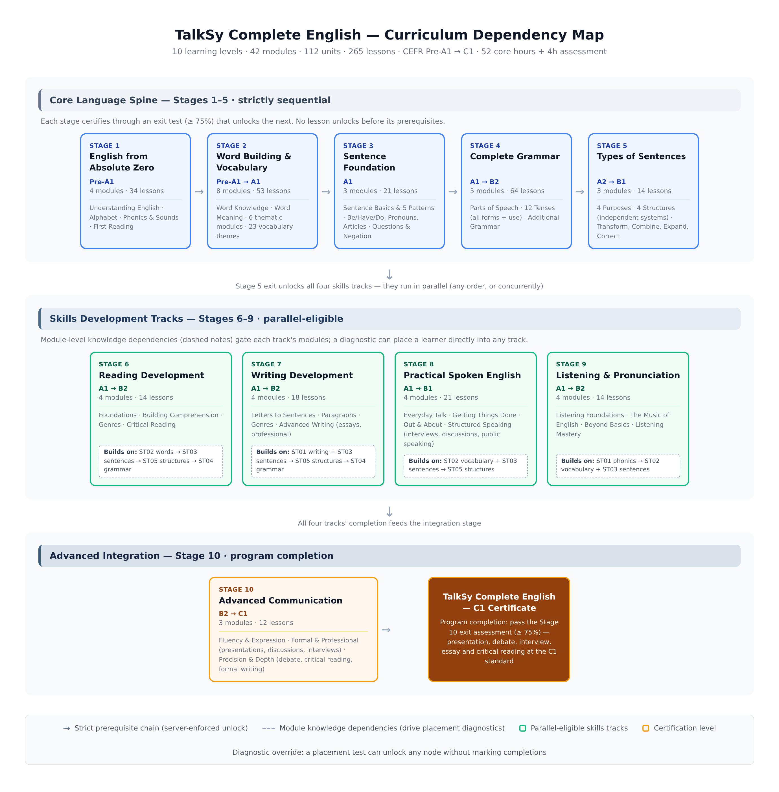

# TalkSy — Curriculum Catalogue

> **Naming.** The product is **TalkSy**. The former working name "EnglishPath" is retired; any historical reference to it means TalkSy.

| | |
| --- | --- |
| **Course** | TalkSy Complete English (`talksy-complete-english`) v1.0.0 |
| **Structure** | Course → Learning Level (Stage) → Module → Unit → Lesson → Practice → Assessment |
| **Scale** | 10 levels · 42 modules · 112 units · 265 lessons · 52.3h core + 4.3h assessment |
| **CEFR span** | Pre-A1 → C1 (lessons: Pre-A1 39 · A1 92 · A2 54 · B1 51 · B2 22 · C1 7) |
| **Source of truth** | `src/data/catalogue/*.json` (database-import shaped) · full graph: `src/data/catalogue/dependency-graph.json` |
| **Licence** | All curriculum content is original educational material authored for TalkSy. No third-party course content is used. |

---

## 1. Purpose and how to read this document

This catalogue is the **complete, dependency-aware educational structure** of the TalkSy English program: every learning level, module, unit and lesson from absolute zero to C1, with objectives, prerequisites, durations, practice composition, assessment criteria and four-skill connections.

It specifies WHAT is taught, in WHAT order, and what must be demonstrated before content unlocks. Full lesson content (vocab cards, dialogues, passages, exercise instances) is authored per release train against these specifications, following the lesson anatomy and integrity gates in [CURRICULUM_BLUEPRINT.md](CURRICULUM_BLUEPRINT.md).

**Design position.** TalkSy is a digital English academy, not a grammar website. Stages 1–5 build the language system (literacy → words → sentences → complete grammar → sentence control); stages 6–9 apply it across the four skills; stage 10 integrates it into advanced communication. Every lesson mixes skills and requires real production — watching is never enough.

## 2. The learning pathway

```
Core Language Spine (strictly sequential)          Skills Tracks (parallel-eligible)
ST01 Absolute Zero → ST02 Words → ST03 Sentences   after ST05, in any order / concurrently:
→ ST04 Complete Grammar → ST05 Sentence Types        ST06 Reading · ST07 Writing
                                                      ST08 Speaking · ST09 Listening
                                                    then: ST10 Advanced Communication → C1
```

- **Stages 1–5 — the spine.** Each stage certifies through an exit assessment (≥ 75%) that unlocks the next. Lessons chain through unit checkpoints; nothing unlocks early.
- **Stages 6–9 — the skills tracks.** Unlocked together by the ST05 exit. Their modules carry *knowledge dependencies* on earlier stages (documented per module below) which drive placement diagnostics and the "recommended after" affordance — the tracks may be taken in any order or concurrently.
- **Stage 10 — integration.** Requires the spine and the four tracks; completing it certifies the program at C1.



**CEFR mapping and PRD alignment.** Completing ST01–ST05 plus the mid-band modules of the tracks corresponds to the PRD's B1 curriculum (FR-CURR-05); the upper-band modules and ST10-M01/M02 correspond to B2 (FR-CURR-06); full program completion corresponds to C1 (FR-CURR-07). Requirement IDs refer to [PRODUCT_REQUIREMENTS.md](PRODUCT_REQUIREMENTS.md).

## 3. Assessment architecture

| Layer | What it is | Threshold | Gates |
| --- | --- | --- | --- |
| Lesson practice | The exercise set inside every lesson (all four skills per the methodology) | ≥ 70% first-attempt target | Lesson completion |
| Unit checkpoint | Mastery quiz at the end of every unit (112 total) | ≥ 80% | Next unit |
| Stage exit test | Certification at the end of every level (10 total) | ≥ 75% | Next stage (tracks: ST05 → ST06–ST09 → ST10) |
| Program completion | ST10 exit assessment | ≥ 75% | TalkSy Complete English certificate (C1) |

**Unlock rule.** A lesson unlocks only when all prerequisite nodes are satisfied: the previous lesson, gated by the unit checkpoint, chained through module exits to the stage exit, and the strict stage entry requirements. **Diagnostic override:** a placement assessment (PRD FR-ASM-01) that demonstrates mastery at or above a node's band unlocks that node — and everything it gates — without marking anything complete (honest-progress rule). Skipped content stays open for review forever.

**Honesty rules carried through.** Speaking is practice, never a quiz penalty; pronunciation is graded for intelligibility, never native-likeness; meaning-first — every grammar item asks what the sentence communicates, not only its form; English spelling patterns are taught together with their exceptions, never as a perfectly regular system.

## 4. Content standards

**Lesson anatomy** (authored per release train): 6–10 vocab items · dialogue (two voices, slow replay) · grammar in context · optional passage · ≥ 7 exercises covering mcq, fill, order, match, listen, speak (listen + speak mandatory in every lesson — test-enforced) · 8–15 minutes. Practice descriptors in the catalogue (e.g. `transformation-drill`, `role-play`, `dictation`) define the exercise mix each lesson must implement.

**Tense coverage.** Every tense unit spans two lessons — *Form and Meaning* (structure, affirmative, negative, interrogative, WH-questions, verb forms, auxiliary verbs) and *Use and Practice* (meaning and use, time expressions, everyday examples, dialogue examples, common mistakes, translation exercises, sentence transformation, speaking and writing practice) — so all fifteen required attributes are covered for each of the twelve tenses, always meaning-first.

**Vocabulary standard — every item carries 12 fields.** Word · phonetic (IPA where available) · audio pronunciation (TTS, no external keys) · simple-English definition · optional support-language translation · example sentence · part of speech · related words · common collocations · difficulty (CEFR) · revision status (import-time `new`; live status is the per-learner Leitner strength in `VocabularyProgress`) · stable id (`{unitId}-w{nn}`). Two exemplar theme sets are fully authored to this standard: Family (`vocabulary/theme-family.json`, 16 items) and Technology (`vocabulary/theme-technology.json`, 12 items). Sample item:

```json
{
  "id": "st02-m03-u02-w02",
  "word": "mother",
  "phonetic": "/ˈmʌð.ər/",
  "audio": {
    "source": "tts",
    "text": "mother",
    "speed": "normal"
  },
  "definition": "your female parent",
  "translations": {},
  "example": "My mother is a teacher.",
  "pos": "noun",
  "relatedWords": [
    "mom",
    "mum",
    "parent",
    "father"
  ],
  "collocations": [
    "my mother",
    "mother and father",
    "stay with my mother"
  ],
  "difficulty": "A1",
  "revisionStatus": "new"
}
```

## 5. Stage catalogue

### ST01 · English from Absolute Zero — Pre-A1

> **Goal.** Take a learner with zero English to full alphabetic literacy: recognising, naming, writing and sounding out all 26 letters, and reading and spelling their first words and sentences.

**Entry requirements:** none (program start) · **Modules:** 4 · **Units:** 13 · **Lessons:** 34 · **Core time:** ~6.2h

#### ST01-M01 — Understanding English

*What English is, what a language is, how spoken and written English differ, and how the building blocks from letters to sentences fit together.*

**ST01-M01-U01 · Language and English**

| Lesson | Title | CEFR | Min | Skills |
| --- | --- | --- | --- | --- |
| `st01-m01-u01-l01` | What Is a Language? What Is English? — Explain in simple words what a language is; Recognise English words in everyday pictures and sounds | Pre-A1 | 12 | listening, reading |
| `st01-m01-u01-l02` | Spoken versus Written English — Tell spoken English from written English apart; Match short spoken phrases to their written form | Pre-A1 | 10 | listening, reading |

*Checkpoint (pass ≥ 80%): Distinguish spoken from written English samples and identify English among other languages.*

**ST01-M01-U02 · How English Works**

| Lesson | Title | CEFR | Min | Skills |
| --- | --- | --- | --- | --- |
| `st01-m01-u02-l01` | Letters, Sounds, Words, Phrases and Sentences — Order the building blocks from letter to sentence; Hear the difference between a word and a phrase | Pre-A1 | 12 | listening, reading |
| `st01-m01-u02-l02` | How English Communication Works — Understand communication as message sent and received; Respond to simple greetings and instructions | Pre-A1 | 10 | listening, speaking |
| `st01-m01-u02-l03` | Introduction to Reading and Writing — Say what reading and writing are for; Trace and copy first letters and words | Pre-A1 | 10 | reading, writing |

*Checkpoint (pass ≥ 80%): Order building blocks letter to sentence and complete a first read-and-copy task.*

#### ST01-M02 — English Alphabet

*All 26 letters: names, recognition, uppercase and lowercase forms, handwriting, vowels versus consonants, sequencing, missing letters and capitalisation basics.*

**ST01-M02-U01 · Letter Recognition**

| Lesson | Title | CEFR | Min | Skills |
| --- | --- | --- | --- | --- |
| `st01-m02-u01-l01` | The Alphabet A-Z: Letter Names and Sequence — Say the 26 letter names in order; Recognise letters heard aloud | Pre-A1 | 12 | listening, speaking, reading |
| `st01-m02-u01-l02` | Uppercase Letters (Capitals) — Recognise all uppercase letters; Write uppercase letters from memory or by copying | Pre-A1 | 10 | reading, writing |
| `st01-m02-u01-l03` | Lowercase Letters — Recognise all lowercase letters; Write lowercase letters from memory or by copying | Pre-A1 | 10 | reading, writing |
| `st01-m02-u01-l04` | Matching Uppercase and Lowercase — Match every uppercase letter to its lowercase partner; Read words with mixed case | Pre-A1 | 10 | reading |

*Checkpoint (pass ≥ 90%): Name, recognise and match all 26 letters in both cases.*

**ST01-M02-U02 · Vowels and Consonants**

| Lesson | Title | CEFR | Min | Skills |
| --- | --- | --- | --- | --- |
| `st01-m02-u02-l01` | Vowels: A, E, I, O, U — Name the five (sometimes six) vowel letters; Pick vowels out of any word | Pre-A1 | 10 | reading, listening |
| `st01-m02-u02-l02` | Consonants — Recognise the 20 consonant letters; Separate vowels from consonants in words | Pre-A1 | 10 | reading |

*Checkpoint (pass ≥ 90%): Classify all 26 letters as vowels or consonants.*

**ST01-M02-U03 · Alphabet Skills**

| Lesson | Title | CEFR | Min | Skills |
| --- | --- | --- | --- | --- |
| `st01-m02-u03-l01` | Alphabet Sequencing — Say which letter comes before or after another; Order shuffled letters correctly | Pre-A1 | 10 | reading, listening |
| `st01-m02-u03-l02` | Identifying Missing Letters — Find the missing letter in a sequence; Spell simple letter sequences from memory | Pre-A1 | 10 | reading, writing |
| `st01-m02-u03-l03` | Capitalisation Basics — Use a capital letter for I, names and sentence starts; Spot wrongly lowercase or uppercase text | Pre-A1 | 10 | reading, writing |

*Checkpoint (pass ≥ 80%): Sequence the alphabet, find missing letters and apply capitalisation basics.*

**ST01-M02-U04 · Writing and Review**

| Lesson | Title | CEFR | Min | Skills |
| --- | --- | --- | --- | --- |
| `st01-m02-u04-l01` | Letter Writing Practice — Form all 26 letters by hand or keyboard with correct shape; Write the alphabet from memory in under two minutes | Pre-A1 | 12 | writing, listening |
| `st01-m02-u04-l02` | Alphabet Review and Exercises — Consolidate the whole alphabet: names, forms, order, case; Self-check readiness for phonics | Pre-A1 | 12 | reading, writing, listening, speaking |

*Checkpoint (pass ≥ 90%): Pass the mixed alphabet review: names, cases, order, vowels and capitals.*

#### ST01-M03 — Phonics and Sounds

*Letter names versus letter sounds, short and long vowels, consonants, blends, digraphs, letter combinations and the honest truth about sound-spelling patterns and their exceptions.*

**ST01-M03-U01 · Sound Awareness**

| Lesson | Title | CEFR | Min | Skills |
| --- | --- | --- | --- | --- |
| `st01-m03-u01-l01` | Letter Names versus Letter Sounds — Tell a letter's name from its sound; Produce the common sound of each letter | Pre-A1 | 12 | listening, speaking |
| `st01-m03-u01-l02` | Basic Sound Awareness — Hear beginning and ending sounds of words; Recognise rhyming words | Pre-A1 | 10 | listening |

*Checkpoint (pass ≥ 80%): Distinguish letter names from sounds and isolate beginning, ending and rhyming sounds.*

**ST01-M03-U02 · Vowel Sounds**

| Lesson | Title | CEFR | Min | Skills |
| --- | --- | --- | --- | --- |
| `st01-m03-u02-l01` | Short Vowel Sounds — Hear and say the five short vowel sounds; Connect short vowels to example words like cat and bed | Pre-A1 | 12 | listening, speaking |
| `st01-m03-u02-l02` | Long Vowel Sounds — Hear and say the five long vowel sounds; Contrast short and long vowel pairs like cat and cake | Pre-A1 | 12 | listening, speaking |

*Checkpoint (pass ≥ 80%): Discriminate and produce all short and long vowel sounds.*

**ST01-M03-U03 · Consonant Sounds**

| Lesson | Title | CEFR | Min | Skills |
| --- | --- | --- | --- | --- |
| `st01-m03-u03-l01` | Common Consonant Sounds — Produce the common sound of each consonant; Match consonant sounds to letters and words | Pre-A1 | 12 | listening, speaking, reading |
| `st01-m03-u03-l02` | Consonant Blends — Blend two or three consonants together like bl, cr and st; Hear blends at the start and end of words | Pre-A1 | 12 | listening, speaking, reading |
| `st01-m03-u03-l03` | Digraphs: ch, sh, th, ph, wh — Say the single sound of each digraph; Recognise digraphs inside simple words | Pre-A1 | 12 | listening, speaking, reading |

*Checkpoint (pass ≥ 80%): Produce consonant sounds, blends and digraphs in isolation and in words.*

**ST01-M03-U04 · Sound and Spelling Patterns**

| Lesson | Title | CEFR | Min | Skills |
| --- | --- | --- | --- | --- |
| `st01-m03-u04-l01` | Common Letter Combinations — Recognise frequent pairs like ee, oo, ai and oa; Read simple words containing these combinations | Pre-A1 | 10 | reading, listening |
| `st01-m03-u04-l02` | Sound Recognition Practice — Identify sounds in the beginning, middle and end of words; Match identical sounds across different words | Pre-A1 | 10 | listening |
| `st01-m03-u04-l03` | Pronunciation Basics — Pronounce practised sounds clearly; Slow down and self-correct when a sound is unclear | Pre-A1 | 10 | listening, speaking |
| `st01-m03-u04-l04` | Sound and Spelling Relationships: Patterns and Exceptions — Use reliable patterns such as short vowels in CVC words; Accept and expect exceptions: same sound spelled differently, silent letters, words like said and one | Pre-A1 | 12 | reading, listening, speaking |

*Checkpoint (pass ≥ 80%): Apply common sound-spelling patterns and state clearly that English spelling has exceptions.*

#### ST01-M04 — First Reading Skills

*Blending letters into words, first CVC reading, word patterns, sight words, phrases, simple sentences and the first spelling exercises.*

**ST01-M04-U01 · Reading Words**

| Lesson | Title | CEFR | Min | Skills |
| --- | --- | --- | --- | --- |
| `st01-m04-u01-l01` | Combining Letters: Blending — Blend two and three sounds into words; Read nonsense practice syllables to master the mechanic | Pre-A1 | 12 | reading, speaking |
| `st01-m04-u01-l02` | Reading Simple Words (CVC) — Read consonant-vowel-consonant words like cat, bed and sit; Match read words to pictures | Pre-A1 | 12 | reading |
| `st01-m04-u01-l03` | Recognising Common Word Patterns — Read word families like -at, -an and -ig; Generate new family members by changing the first letter | Pre-A1 | 10 | reading |

*Checkpoint (pass ≥ 80%): Blend sounds and read CVC words and simple word families.*

**ST01-M04-U02 · Reading Phrases and Sentences**

| Lesson | Title | CEFR | Min | Skills |
| --- | --- | --- | --- | --- |
| `st01-m04-u02-l01` | Reading Short Phrases — Read two- and three-word phrases smoothly; Match phrases to pictures | Pre-A1 | 10 | reading, listening |
| `st01-m04-u02-l02` | Basic Sight Vocabulary — Recognise the 20 most frequent English words instantly; Read sight words inside simple sentences | Pre-A1 | 12 | reading |
| `st01-m04-u02-l03` | Reading Simple Sentences — Read 3-6 word sentences with understanding; Show comprehension by choosing the matching picture | Pre-A1 | 12 | reading, listening |

*Checkpoint (pass ≥ 80%): Read sight words, phrases and simple sentences with understanding.*

**ST01-M04-U03 · First Spelling**

| Lesson | Title | CEFR | Min | Skills |
| --- | --- | --- | --- | --- |
| `st01-m04-u03-l01` | Initial Spelling Exercises — Spell practised CVC words from sounds; Apply beginning capitalisation and end punctuation | Pre-A1 | 12 | listening, writing |

*Checkpoint (pass ≥ 80%): Spell practised CVC words from dictation with basic punctuation.*

> **Foundations Exit Test** (`st01-exit`, 20 min, pass ≥ 75%, unlocks st02): Alphabet names, cases and order; vowel and consonant sounds including blends and digraphs; read 15 CVC and pattern words; recognise 20 sight words; read 5 simple sentences; spell 10 dictated words. The test explicitly includes irregular items so learners meet exceptions honestly.

---

### ST02 · Word Building and Vocabulary — Pre-A1 → A1

> **Goal.** Build the learner's first working vocabulary and word skills — from word structure and formation to 23 thematic word sets — with every word heard, said, read and used in context.

**Entry requirements:** st01-exit · **Modules:** 8 · **Units:** 29 · **Lessons:** 53 · **Core time:** ~10.6h

#### ST02-M01 — Word Knowledge

*What words are made of: structure, syllables, three- and four-letter words, spelling patterns, word families, compounds, prefixes, suffixes and word formation.*

**ST02-M01-U01 · What Is a Word?**

| Lesson | Title | CEFR | Min | Skills |
| --- | --- | --- | --- | --- |
| `st02-m01-u01-l01` | What Is a Word? Word Structure — Explain what a word is; Break a word into letters and sounds | Pre-A1 | 12 | reading, listening |
| `st02-m01-u01-l02` | Letters and Syllables — Hear syllable breaks in words; Clap and count syllables | Pre-A1 | 12 | listening, speaking |
| `st02-m01-u01-l03` | Three-Letter and Four-Letter Words — Read and spell common three- and four-letter words; Build words letter by letter | Pre-A1 | 12 | reading, writing |

*Checkpoint (pass ≥ 80%): Explain word structure, count syllables and read/spell short words.*

**ST02-M01-U02 · Spelling Patterns and Families**

| Lesson | Title | CEFR | Min | Skills |
| --- | --- | --- | --- | --- |
| `st02-m01-u02-l01` | Common Spelling Patterns — Read CVC, CVCe and double-letter patterns; Choose the right pattern when spelling | Pre-A1 | 12 | reading, writing |
| `st02-m01-u02-l02` | Word Families — Read word families like -at, -an, -ing and -og; Build new words by swapping onset letters | Pre-A1 | 12 | reading |

*Checkpoint (pass ≥ 80%): Use spelling patterns and word families when reading and spelling.*

**ST02-M01-U03 · Building Words**

| Lesson | Title | CEFR | Min | Skills |
| --- | --- | --- | --- | --- |
| `st02-m01-u03-l01` | Compound Words — Build compounds from two words like bedroom and raincoat; Split compounds into their parts | A1 | 12 | reading, writing |
| `st02-m01-u03-l02` | Prefixes — Understand how un- and re- change meaning; Decode new words using prefixes | A1 | 12 | reading, writing |
| `st02-m01-u03-l03` | Suffixes — Understand how -s, -er and -ing attach to words; Form correct spelling changes when adding suffixes | A1 | 12 | reading, writing |
| `st02-m01-u03-l04` | Word Formation Overview — Combine families, compounds, prefixes and suffixes to grow vocabulary; Explain how a new word was built | A1 | 10 | reading, writing, speaking |

*Checkpoint (pass ≥ 80%): Build words with compounds, prefixes and suffixes and explain their structure.*

#### ST02-M02 — Word Meaning and Relationships

*How words relate: singular and plural forms, synonyms, antonyms, homophones, homonyms, collocations and a first look at phrasal verbs.*

**ST02-M02-U01 · Word Forms**

| Lesson | Title | CEFR | Min | Skills |
| --- | --- | --- | --- | --- |
| `st02-m02-u01-l01` | Singular and Plural Forms — Form regular plurals with -s and -es; Recognise common irregular plurals like children and feet | A1 | 12 | reading, writing, listening |

*Checkpoint (pass ≥ 80%): Transform singular to plural including common irregular forms.*

**ST02-M02-U02 · Meaning Relations**

| Lesson | Title | CEFR | Min | Skills |
| --- | --- | --- | --- | --- |
| `st02-m02-u02-l01` | Synonyms — Match words with similar meanings like big and large; Choose the best synonym for a context | A1 | 12 | reading, writing |
| `st02-m02-u02-l02` | Antonyms — Match opposite word pairs like hot and cold; Use antonym pairs in simple sentences | A1 | 12 | reading, writing |
| `st02-m02-u02-l03` | Homophones — Hear that words like to, two and too sound the same; Choose the correct homophone in writing | A1 | 12 | listening, reading, writing |
| `st02-m02-u02-l04` | Homonyms — Understand words with one form and two meanings like bat; Decide meaning from context | A1 | 12 | reading, listening |
| `st02-m02-u02-l05` | Collocations — Recognise natural word partners like make coffee and do homework; Reject unnatural pairings | A1 | 12 | reading, listening |

*Checkpoint (pass ≥ 80%): Navigate synonyms, antonyms, homophones, homonyms and collocations.*

**ST02-M02-U03 · Multi-Word Verbs**

| Lesson | Title | CEFR | Min | Skills |
| --- | --- | --- | --- | --- |
| `st02-m02-u03-l01` | Phrasal Verbs: Introduction — Understand that verb plus particle makes a new meaning like get up; Use 6 high-frequency phrasal verbs | A1 | 12 | reading, listening, speaking |

*Checkpoint (pass ≥ 80%): Recognise and use the six target phrasal verbs.*

#### ST02-M03 — People and Emotions

*Thematic vocabulary for people, relationships, family and emotions — the first full thematic sets, taught to the 12-field vocabulary standard.*

**ST02-M03-U01 · People and Relationships**

| Lesson | Title | CEFR | Min | Skills |
| --- | --- | --- | --- | --- |
| `st02-m03-u01-l01` | People Words: Who We Are — Learn 10-12 core people words like man, woman, boy and friend; Describe who someone is in one sentence | A1 | 12 | listening, speaking, reading, writing |
| `st02-m03-u01-l02` | Relationships: Family, Friends and Others — Learn relationship words like neighbour, classmate and best friend; Talk about who people are to you | A1 | 12 | listening, speaking, reading, writing |

*Checkpoint (pass ≥ 80%): Use people and relationship vocabulary accurately in description and dialogue.*

**ST02-M03-U02 · Family**

| Lesson | Title | CEFR | Min | Skills |
| --- | --- | --- | --- | --- |
| `st02-m03-u02-l01` | Family Members — Learn 14-16 family words from mother to grandparents; Ask and answer the question: Is this your family member? | A1 | 12 | listening, speaking, reading, writing |
| `st02-m03-u02-l02` | Talking about Your Family — Describe your family in 3-4 sentences; Understand a simple family introduction dialogue | A1 | 12 | listening, speaking |

*Checkpoint (pass ≥ 80%): Describe a family accurately and understand family dialogues.*

**ST02-M03-U03 · Emotions**

| Lesson | Title | CEFR | Min | Skills |
| --- | --- | --- | --- | --- |
| `st02-m03-u03-l01` | Feelings and Emotions — Learn 12 feeling words from happy to tired; Say how you feel today and why in one sentence | A1 | 12 | listening, speaking, reading, writing |

*Checkpoint (pass ≥ 80%): Name emotions and express feelings in simple sentences.*

#### ST02-M04 — Body and Health

*Body parts, describing people, health and illness vocabulary, and first doctor conversations.*

**ST02-M04-U01 · Body**

| Lesson | Title | CEFR | Min | Skills |
| --- | --- | --- | --- | --- |
| `st02-m04-u01-l01` | Parts of the Body — Learn 14-16 body words from head to feet; Point to and name body parts on request | A1 | 12 | listening, speaking, reading, writing |
| `st02-m04-u01-l02` | Describing People and Bodies — Describe height, hair and age with simple adjectives; Understand descriptions and identify the person | A1 | 12 | listening, speaking, reading |

*Checkpoint (pass ≥ 80%): Name body parts and describe people physically.*

**ST02-M04-U02 · Health**

| Lesson | Title | CEFR | Min | Skills |
| --- | --- | --- | --- | --- |
| `st02-m04-u02-l01` | Health and Illness Words — Learn illness words like headache, cold and fever; Say what hurts using My ... hurts | A1 | 12 | listening, speaking, reading, writing |
| `st02-m04-u02-l02` | At the Doctor: First Conversation — Follow and produce a 6-line doctor dialogue; Answer the questions: How do you feel, and what hurts? | A1 | 12 | listening, speaking |

*Checkpoint (pass ≥ 80%): Describe symptoms and complete a first doctor conversation.*

#### ST02-M05 — Home, Food and Clothes

*Everyday living vocabulary: rooms, furniture, household objects, food and drink, meals, clothes and describing what people wear.*

**ST02-M05-U01 · Home**

| Lesson | Title | CEFR | Min | Skills |
| --- | --- | --- | --- | --- |
| `st02-m05-u01-l01` | Rooms and Furniture — Learn 12-14 words for rooms and main furniture; Describe where things are in a home | A1 | 12 | listening, speaking, reading, writing |
| `st02-m05-u01-l02` | Things at Home — Learn 12 household objects from chair to window; Say what is in a room using there is / there are | A1 | 12 | listening, speaking, reading, writing |

*Checkpoint (pass ≥ 80%): Describe a home: rooms, furniture and objects with there is/are.*

**ST02-M05-U02 · Food**

| Lesson | Title | CEFR | Min | Skills |
| --- | --- | --- | --- | --- |
| `st02-m05-u02-l01` | Food and Drink — Learn 16 core food and drink words; Sort foods into categories like fruit, drink and meat | A1 | 12 | listening, speaking, reading, writing |
| `st02-m05-u02-l02` | Meals and Eating — Use meal words breakfast, lunch and dinner with times; Say what you like, love and do not like | A1 | 12 | listening, speaking, reading |

*Checkpoint (pass ≥ 80%): Name foods and meals and express likes and dislikes.*

**ST02-M05-U03 · Clothes**

| Lesson | Title | CEFR | Min | Skills |
| --- | --- | --- | --- | --- |
| `st02-m05-u03-l01` | Clothes and Accessories — Learn 12-14 clothing words from shirt to shoes; Match clothes to weather and situations | A1 | 12 | listening, speaking, reading, writing |
| `st02-m05-u03-l02` | Describing Clothes — Describe what someone is wearing with colours; Identify a person from a clothing description | A1 | 12 | listening, speaking, reading |

*Checkpoint (pass ≥ 80%): Name clothes and describe what people are wearing.*

#### ST02-M06 — Numbers, Time, Colours and Shopping

*The number system, telling the time, days, months and dates, colours, shops, products, money and prices.*

**ST02-M06-U01 · Numbers**

| Lesson | Title | CEFR | Min | Skills |
| --- | --- | --- | --- | --- |
| `st02-m06-u01-l01` | Numbers 1-20 — Count from 1 to 20 aloud; Recognise numbers heard quickly | A1 | 12 | listening, speaking, reading, writing |
| `st02-m06-u01-l02` | Numbers 20-100 and Beyond — Say and understand numbers to 100 and to 1000; Use numbers for ages, quantities and years | A1 | 12 | listening, speaking, reading, writing |

*Checkpoint (pass ≥ 80%): Count, understand and use numbers to 100 and beyond.*

**ST02-M06-U02 · Time**

| Lesson | Title | CEFR | Min | Skills |
| --- | --- | --- | --- | --- |
| `st02-m06-u02-l01` | Telling the Time — Say times with o'clock, half past and quarter past/to; Ask and answer the question: What time is it? | A1 | 12 | listening, speaking, reading |

*Checkpoint (pass ≥ 80%): Tell the time and exchange times in dialogue.*

**ST02-M06-U03 · Days and Months**

| Lesson | Title | CEFR | Min | Skills |
| --- | --- | --- | --- | --- |
| `st02-m06-u03-l01` | Days, Months and Dates — Say the days of the week and months in order; Say and write dates like the 3rd of May | A1 | 12 | listening, speaking, reading, writing |

*Checkpoint (pass ≥ 80%): Use days, months and dates accurately.*

**ST02-M06-U04 · Colours**

| Lesson | Title | CEFR | Min | Skills |
| --- | --- | --- | --- | --- |
| `st02-m06-u04-l01` | Colours and Shades — Learn 10-12 colour words; Describe objects with colour plus noun order | A1 | 12 | listening, speaking, reading, writing |

*Checkpoint (pass ≥ 80%): Describe things using colour vocabulary correctly.*

**ST02-M06-U05 · Shopping**

| Lesson | Title | CEFR | Min | Skills |
| --- | --- | --- | --- | --- |
| `st02-m06-u05-l01` | Shops and Products — Learn shop types and common products; Say where you buy things | A1 | 12 | listening, speaking, reading, writing |
| `st02-m06-u05-l02` | Money and Prices — Ask and say prices: How much is it?; Understand prices said aloud and written | A1 | 12 | listening, speaking, reading, writing |

*Checkpoint (pass ≥ 80%): Shop vocabulary mastery: products, shops, money and prices in dialogue.*

#### ST02-M07 — The World Around Us

*Weather, animals, transport, travel words and travel situations, and nature and environment vocabulary.*

**ST02-M07-U01 · Weather**

| Lesson | Title | CEFR | Min | Skills |
| --- | --- | --- | --- | --- |
| `st02-m07-u01-l01` | Weather Words — Learn 10-12 weather words from sunny to snowy; Ask and answer the question: What is the weather like? | A1 | 12 | listening, speaking, reading, writing |

*Checkpoint (pass ≥ 80%): Describe weather and exchange weather information.*

**ST02-M07-U02 · Animals**

| Lesson | Title | CEFR | Min | Skills |
| --- | --- | --- | --- | --- |
| `st02-m07-u02-l01` | Animals and Pets — Learn 12-14 animal words including pets and farm animals; Say which animals you like and have | A1 | 12 | listening, speaking, reading, writing |

*Checkpoint (pass ≥ 80%): Name animals and talk about them simply.*

**ST02-M07-U03 · Transportation**

| Lesson | Title | CEFR | Min | Skills |
| --- | --- | --- | --- | --- |
| `st02-m07-u03-l01` | Transport and Getting Around — Learn 10-12 transport words; Say how you travel: by bus, by car, on foot | A1 | 12 | listening, speaking, reading, writing |

*Checkpoint (pass ≥ 80%): Name transport modes and describe how you travel.*

**ST02-M07-U04 · Travel**

| Lesson | Title | CEFR | Min | Skills |
| --- | --- | --- | --- | --- |
| `st02-m07-u04-l01` | Travel Words and Places — Learn 12-14 travel words from ticket to suitcase; Understand simple travel announcements | A1 | 12 | listening, speaking, reading, writing |
| `st02-m07-u04-l02` | Travel Situations: Airport and Hotel — Handle check-in and simple airport situations; Ask 3 hotel questions: room, key, breakfast | A1 | 12 | listening, speaking |

*Checkpoint (pass ≥ 80%): Use travel vocabulary in airport and hotel situations.*

**ST02-M07-U05 · Environment**

| Lesson | Title | CEFR | Min | Skills |
| --- | --- | --- | --- | --- |
| `st02-m07-u05-l01` | Nature and the Environment — Learn 10-12 nature words like tree, river and sky; Describe a simple natural scene | A1 | 12 | listening, speaking, reading, writing |

*Checkpoint (pass ≥ 80%): Use nature and environment vocabulary to describe scenes.*

#### ST02-M08 — School, Work and Society

*Education and classroom words, jobs, the workplace, everyday technology, and people and places in society.*

**ST02-M08-U01 · Education**

| Lesson | Title | CEFR | Min | Skills |
| --- | --- | --- | --- | --- |
| `st02-m08-u01-l01` | School and University Words — Learn 12-14 school words from teacher to student; Describe your school simply | A1 | 12 | listening, speaking, reading, writing |
| `st02-m08-u01-l02` | Subjects and the Classroom — Name school subjects like maths and history; Follow 8 classroom instructions | A1 | 12 | listening, speaking, reading |

*Checkpoint (pass ≥ 80%): Use school vocabulary and follow classroom language.*

**ST02-M08-U02 · Jobs**

| Lesson | Title | CEFR | Min | Skills |
| --- | --- | --- | --- | --- |
| `st02-m08-u02-l01` | Jobs and Work Words — Learn 12-14 job words from doctor to driver; Ask the question: What do you do? | A1 | 12 | listening, speaking, reading, writing |
| `st02-m08-u02-l02` | Describing Your Job — Say where you work and what you do in 3 sentences; Understand simple job descriptions | A1 | 12 | listening, speaking, reading |

*Checkpoint (pass ≥ 80%): Talk about jobs: names, workplaces and activities.*

**ST02-M08-U03 · Workplace**

| Lesson | Title | CEFR | Min | Skills |
| --- | --- | --- | --- | --- |
| `st02-m08-u03-l01` | The Workplace and Office Words — Learn 12 office words from meeting to colleague; Describe a typical workplace | A2 | 12 | listening, speaking, reading, writing |
| `st02-m08-u03-l02` | Colleagues and Work Life — Talk about colleagues and work routines; Understand a simple workplace dialogue | A2 | 12 | listening, speaking, reading |

*Checkpoint (pass ≥ 80%): Discuss workplaces, colleagues and routines with core office vocabulary.*

**ST02-M08-U04 · Technology**

| Lesson | Title | CEFR | Min | Skills |
| --- | --- | --- | --- | --- |
| `st02-m08-u04-l01` | Everyday Technology — Learn 12 technology words from phone to internet; Say which devices you use and what for | A2 | 12 | listening, speaking, reading, writing |
| `st02-m08-u04-l02` | Using Phones and Computers — Use action words like send, download and charge; Handle simple digital situations: password, message, app | A2 | 12 | listening, speaking, reading, writing |

*Checkpoint (pass ≥ 80%): Use everyday technology vocabulary for devices, actions and situations.*

**ST02-M08-U05 · Society**

| Lesson | Title | CEFR | Min | Skills |
| --- | --- | --- | --- | --- |
| `st02-m08-u05-l01` | People and Places in Society — Learn 10-12 words for places and roles in society like city, village and police officer; Describe where you live | A2 | 12 | listening, speaking, reading, writing |

*Checkpoint (pass ≥ 80%): Describe community and society with the target vocabulary.*

> **Word Builder Exit Test** (`st02-exit`, 25 min, pass ≥ 75%, unlocks st03): Word structure and formation (compounds, prefixes, suffixes); plural forms; meaning relations (synonyms, antonyms, homophones); listening recognition of 60+ thematic words across all 23 themes; production of 40+ words in context; first dialogues (family, shopping, doctor).

---

### ST03 · Sentence Foundation — A1

> **Goal.** Construct the learner's first English sentences with correct word order, the five basic sentence patterns, and essential question and negation forms.

**Entry requirements:** st02-exit · **Modules:** 3 · **Units:** 7 · **Lessons:** 21 · **Core time:** ~4.2h

#### ST03-M01 — Sentence Basics

*What a sentence is, complete versus incomplete sentences, subject, predicate, verb, object and complement, English word order and the five basic sentence patterns.*

**ST03-M01-U01 · What Is a Sentence?**

| Lesson | Title | CEFR | Min | Skills |
| --- | --- | --- | --- | --- |
| `st03-m01-u01-l01` | What Is a Sentence? Complete versus Incomplete — Tell a complete sentence from an incomplete fragment; Finish fragments into full sentences | A1 | 12 | reading, writing, listening |
| `st03-m01-u01-l02` | Subject and Predicate — Find the subject of a sentence; Find the predicate (what is said about the subject) | A1 | 12 | reading, writing |
| `st03-m01-u01-l03` | Verb, Object and Complement — Identify the verb in any practised sentence; Recognise objects and complements after the verb | A1 | 12 | reading, writing |

*Checkpoint (pass ≥ 80%): Identify sentence parts (subject, predicate, verb, object, complement) and distinguish sentences from fragments.*

**ST03-M01-U02 · Sentence Patterns**

| Lesson | Title | CEFR | Min | Skills |
| --- | --- | --- | --- | --- |
| `st03-m01-u02-l01` | Word Order: Subject + Verb and Subject + Verb + Object — Apply English subject-first word order; Build SV and SVO sentences from prompts | A1 | 12 | reading, writing, speaking |
| `st03-m01-u02-l02` | Subject + Verb + Complement — Use SVC sentences with be and other linking verbs; Understand that the complement describes the subject | A1 | 12 | reading, writing |
| `st03-m01-u02-l03` | Subject + Verb + Indirect Object + Direct Object — Build SVoO sentences like She gave me a book; Switch between the two object orders with to and for | A1 | 12 | reading, writing |
| `st03-m01-u02-l04` | Subject + Verb + Object + Complement — Build SVOC sentences like They made her happy; Distinguish SVOC from SVO and SVC | A1 | 12 | reading, writing |

*Checkpoint (pass ≥ 80%): Use all five sentence patterns with correct word order.*

#### ST03-M02 — Essential Sentence Words

*The workhorse words of sentences: be, have and do verbs with helping verbs, pronouns, articles, determiners, basic adjectives, adverbs and prepositions.*

**ST03-M02-U01 · Be, Have, Do**

| Lesson | Title | CEFR | Min | Skills |
| --- | --- | --- | --- | --- |
| `st03-m02-u01-l01` | Be Verbs: am, is, are — Use am, is and are with the right subject; Contract forms like I'm and she's | A1 | 12 | listening, speaking, reading, writing |
| `st03-m02-u01-l02` | Have Verbs: have, has — Use have and has correctly; Talk about possession: I have a sister | A1 | 12 | listening, speaking, reading, writing |
| `st03-m02-u01-l03` | Do Verbs: do, does — Use do and does as main verbs and in questions; Form short answers: Yes, I do | A1 | 12 | listening, speaking, reading, writing |
| `st03-m02-u01-l04` | Basic Helping Verbs — Recognise be, have and do as helping verbs; Understand which helping verb each tense needs | A1 | 12 | reading, writing, listening |

*Checkpoint (pass ≥ 80%): Use be, have and do as main and helping verbs with correct forms.*

**ST03-M02-U02 · Pronouns, Articles and Determiners**

| Lesson | Title | CEFR | Min | Skills |
| --- | --- | --- | --- | --- |
| `st03-m02-u02-l01` | Pronouns: I, you, he, she, it, we, they — Use subject pronouns correctly; Replace nouns with pronouns in sentences | A1 | 12 | reading, writing, listening |
| `st03-m02-u02-l02` | Articles: a, an, the — Choose a or an by sound; Use the for specific things and a/an for general | A1 | 12 | reading, writing |
| `st03-m02-u02-l03` | Determiners: this, that, these, those — Choose this/that/these/those by distance and number; Point things out in real situations | A1 | 12 | listening, speaking, reading, writing |

*Checkpoint (pass ≥ 80%): Use pronouns, articles and demonstrative determiners accurately.*

**ST03-M02-U03 · Describing Words and Prepositions**

| Lesson | Title | CEFR | Min | Skills |
| --- | --- | --- | --- | --- |
| `st03-m02-u03-l01` | Basic Adjectives — Use common adjectives before nouns and after be; Put adjectives in the right place | A1 | 12 | reading, writing, speaking |
| `st03-m02-u03-l02` | Basic Adverbs — Form adverbs with -ly and use them to describe actions; Place adverbs like well and fast correctly | A1 | 12 | reading, writing |
| `st03-m02-u03-l03` | Prepositions: in, on, at — Use in, on and at for places; Understand the general size rule with common exceptions | A1 | 12 | reading, writing, listening |

*Checkpoint (pass ≥ 80%): Describe with adjectives and adverbs and use in/on/at for places.*

#### ST03-M03 — Making Sentences

*Affirmative and negative sentences, yes/no questions, WH-questions and subject-verb agreement — putting everything together into real sentence production.*

**ST03-M03-U01 · Polarity and Questions**

| Lesson | Title | CEFR | Min | Skills |
| --- | --- | --- | --- | --- |
| `st03-m03-u01-l01` | Affirmative and Negative Sentences — Make sentences negative with not and n't; Use no as a determiner in simple denials | A1 | 12 | reading, writing, speaking |
| `st03-m03-u01-l02` | Yes/No Questions — Invert be and do to form yes/no questions; Answer with short answers | A1 | 12 | listening, speaking, reading, writing |
| `st03-m03-u01-l03` | WH-Questions: what, where, who, when, why, how — Build WH-questions with be and do; Choose the right question word for each answer | A1 | 12 | listening, speaking, reading, writing |

*Checkpoint (pass ≥ 80%): Form affirmative, negative, yes/no and WH-questions and answer them.*

**ST03-M03-U02 · Agreement**

| Lesson | Title | CEFR | Min | Skills |
| --- | --- | --- | --- | --- |
| `st03-m03-u02-l01` | Subject-Verb Agreement Basics — Match verbs to singular and plural subjects; Spot and fix agreement errors like he go | A1 | 12 | reading, writing, listening |

*Checkpoint (pass ≥ 80%): Apply subject-verb agreement in production and correction tasks.*

> **Sentence Builder Exit Test** (`st03-exit`, 25 min, pass ≥ 75%, unlocks st04): Identify sentence parts; build all five patterns; use be/have/do, pronouns, articles, determiners and prepositions; make negatives, yes/no questions and WH-questions; apply subject-verb agreement in writing and a short spoken interview.

---

### ST04 · Complete Grammar — A1 → B2

> **Goal.** Master the complete English grammar system — parts of speech, all twelve tenses, and the advanced structures — always through meaning and real use, never formulas without context.

**Entry requirements:** st03-exit · **Modules:** 5 · **Units:** 24 · **Lessons:** 64 · **Core time:** ~12.7h

#### ST04-M01 — Parts of Speech

*The nine word classes with their subcategories, uses, examples and the common errors learners make with each.*

**ST04-M01-U01 · Nouns**

| Lesson | Title | CEFR | Min | Skills |
| --- | --- | --- | --- | --- |
| `st04-m01-u01-l01` | Nouns: Types and Uses — Classify common, proper, countable and uncountable nouns; Use nouns in all five sentence patterns | A1 | 12 | reading, writing, listening |
| `st04-m01-u01-l02` | Nouns: Common Errors — Avoid plural errors like informations and advices; Use articles correctly with common nouns | A2 | 10 | reading, writing |

*Checkpoint (pass ≥ 80%): Classify nouns by type and fix common noun errors.*

**ST04-M01-U02 · Pronouns**

| Lesson | Title | CEFR | Min | Skills |
| --- | --- | --- | --- | --- |
| `st04-m01-u02-l01` | Pronouns: Types and Uses — Use subject, object and possessive pronouns; Choose reflexive pronouns like myself where needed | A1 | 12 | reading, writing, listening |
| `st04-m01-u02-l02` | Pronoun Agreement and Errors — Match pronouns to their nouns in number and gender; Avoid errors like between you and I | A2 | 10 | reading, writing |

*Checkpoint (pass ≥ 80%): Use pronouns accurately and fix agreement errors.*

**ST04-M01-U03 · Verbs**

| Lesson | Title | CEFR | Min | Skills |
| --- | --- | --- | --- | --- |
| `st04-m01-u03-l01` | Verbs: Types and Uses — Tell action, linking and helping verbs apart; Match verbs to the sentence patterns they fit | A1 | 12 | reading, writing, listening |
| `st04-m01-u03-l02` | Verb Forms and Patterns — Use base, past, past participle and -ing forms; Learn which verbs take -ing and which take to | A2 | 12 | reading, writing |

*Checkpoint (pass ≥ 80%): Use verb types, forms and basic patterns correctly.*

**ST04-M01-U04 · Adjectives and Adverbs**

| Lesson | Title | CEFR | Min | Skills |
| --- | --- | --- | --- | --- |
| `st04-m01-u04-l01` | Adjectives: Types, Order and Uses — Use fact and opinion adjectives; Order adjectives correctly: a big old red box | A2 | 12 | reading, writing, speaking |
| `st04-m01-u04-l02` | Adverbs: Types and Position — Use adverbs of manner, time, frequency and degree; Place adverbs correctly in a sentence | A2 | 12 | reading, writing, listening |
| `st04-m01-u04-l03` | Adjective and Adverb Errors — Choose good vs well and similar pairs correctly; Fix double-comparative and wrong-form errors | A2 | 10 | reading, writing |

*Checkpoint (pass ≥ 80%): Use adjectives and adverbs with correct order, position and form.*

**ST04-M01-U05 · Prepositions, Conjunctions and Interjections**

| Lesson | Title | CEFR | Min | Skills |
| --- | --- | --- | --- | --- |
| `st04-m01-u05-l01` | Prepositions of Place, Time and Movement — Use in, on, at for time as well as place; Use movement prepositions like to, into, through | A2 | 12 | reading, writing, listening |
| `st04-m01-u05-l02` | Conjunctions: and, but, or, because, so — Join ideas with coordinating conjunctions; Link causes and results with because and so | A1 | 12 | reading, writing |
| `st04-m01-u05-l03` | Interjections and Parts-of-Speech Review — Recognise interjections like oh, wow and ouch in speech; Identify all nine word classes in real sentences | A2 | 12 | reading, listening |

*Checkpoint (pass ≥ 80%): Identify and use all nine word classes, including interjections, in context.*

#### ST04-M02 — The Tense System and Present Tenses

*The map of the English tense system, then the four present tenses. Every tense unit covers, across two lessons: meaning and use, structure, affirmative, negative, interrogative and WH forms, verb forms, auxiliary verbs, time expressions, everyday examples, dialogue examples, common mistakes, translation exercises, sentence transformation, and speaking and writing practice.*

**ST04-M02-U01 · The Tense System**

| Lesson | Title | CEFR | Min | Skills |
| --- | --- | --- | --- | --- |
| `st04-m02-u01-l01` | The English Tense System: An Overview — Understand time (past, present, future) and aspect (simple, continuous, perfect); Read the 12-tense map without fear | A1 | 12 | reading, listening, speaking |

*Checkpoint (pass ≥ 80%): Navigate the 12-tense map: time crossed with aspect.*

**ST04-M02-U02 · Present Simple**

| Lesson | Title | CEFR | Min | Skills |
| --- | --- | --- | --- | --- |
| `st04-m02-u02-l01` | Present Simple: Form and Meaning — Build affirmative, negative and interrogative forms with do/does; Use the third-person -s correctly | A1 | 12 | reading, writing, listening |
| `st04-m02-u02-l02` | Present Simple: Use and Practice — Use time expressions like always, usually, every day; Hear present simple in everyday dialogues | A1 | 12 | listening, speaking, reading, writing |

*Checkpoint (pass ≥ 80%): Use present simple for routines and facts with correct forms, time expressions and third-person -s.*

**ST04-M02-U03 · Present Continuous**

| Lesson | Title | CEFR | Min | Skills |
| --- | --- | --- | --- | --- |
| `st04-m02-u03-l01` | Present Continuous: Form and Meaning — Build forms with be + verb-ing; Understand the meaning: happening now, temporary, changing | A1 | 12 | reading, writing, listening |
| `st04-m02-u03-l02` | Present Continuous: Use and Practice — Use now, at the moment and today; Describe pictures and ongoing activities in speech and writing | A1 | 12 | listening, speaking, reading, writing |

*Checkpoint (pass ≥ 80%): Use present continuous for now and temporary situations and contrast it with present simple.*

**ST04-M02-U04 · Present Perfect**

| Lesson | Title | CEFR | Min | Skills |
| --- | --- | --- | --- | --- |
| `st04-m02-u04-l01` | Present Perfect: Form and Meaning — Build forms with have/has + past participle; Understand the meaning: experience, unfinished time, result now | A2 | 12 | reading, writing, listening |
| `st04-m02-u04-l02` | Present Perfect: Use and Practice — Use ever, never, already, yet and just; Tell experiences: I have visited Japan | A2 | 12 | listening, speaking, reading, writing |

*Checkpoint (pass ≥ 80%): Use present perfect for experiences and results with correct participles and time words.*

**ST04-M02-U05 · Present Perfect Continuous**

| Lesson | Title | CEFR | Min | Skills |
| --- | --- | --- | --- | --- |
| `st04-m02-u05-l01` | Present Perfect Continuous: Form and Meaning — Build forms with have/has been + verb-ing; Understand the meaning: duration up to now | B1 | 12 | reading, writing, listening |
| `st04-m02-u05-l02` | Present Perfect Continuous: Use and Practice — Use for and since with duration; Explain ongoing activities and their visible results | B1 | 12 | listening, speaking, reading, writing |

*Checkpoint (pass ≥ 80%): Use present perfect continuous for duration with for/since and contrast it with present perfect.*

#### ST04-M03 — Past Tenses

*The four past tenses, each with the full attribute set across two lessons: meaning, forms, auxiliaries, time expressions, dialogues, mistakes, translation, transformation and production practice.*

**ST04-M03-U01 · Past Simple**

| Lesson | Title | CEFR | Min | Skills |
| --- | --- | --- | --- | --- |
| `st04-m03-u01-l01` | Past Simple: Form and Meaning — Form regular past with -ed and use the 20 most common irregulars; Build negatives and questions with did | A1 | 12 | reading, writing, listening |
| `st04-m03-u01-l02` | Past Simple: Use and Practice — Use yesterday, last week and ago; Narrate a finished event in order | A1 | 12 | listening, speaking, reading, writing |

*Checkpoint (pass ≥ 80%): Narrate finished past events with regular and irregular verbs.*

**ST04-M03-U02 · Past Continuous**

| Lesson | Title | CEFR | Min | Skills |
| --- | --- | --- | --- | --- |
| `st04-m03-u02-l01` | Past Continuous: Form and Meaning — Build forms with was/were + verb-ing; Understand the meaning: in progress at a past moment | A2 | 12 | reading, writing, listening |
| `st04-m03-u02-l02` | Past Continuous: Use and Practice — Set scenes and describe interrupted actions with when and while; Combine past simple and continuous in stories | A2 | 12 | listening, speaking, reading, writing |

*Checkpoint (pass ≥ 80%): Describe past scenes and interruptions with past continuous plus past simple.*

**ST04-M03-U03 · Past Perfect**

| Lesson | Title | CEFR | Min | Skills |
| --- | --- | --- | --- | --- |
| `st04-m03-u03-l01` | Past Perfect: Form and Meaning — Build forms with had + past participle; Understand the meaning: the earlier of two past events | B1 | 12 | reading, writing, listening |
| `st04-m03-u03-l02` | Past Perfect: Use and Practice — Use before, after and already to sequence events; Narrate cause-and-effect past chains | B1 | 12 | listening, speaking, reading, writing |

*Checkpoint (pass ≥ 80%): Order past events with past perfect where needed.*

**ST04-M03-U04 · Past Perfect Continuous**

| Lesson | Title | CEFR | Min | Skills |
| --- | --- | --- | --- | --- |
| `st04-m03-u04-l01` | Past Perfect Continuous: Form and Meaning — Build forms with had been + verb-ing; Understand the meaning: duration before a past point | B1 | 12 | reading, writing, listening |
| `st04-m03-u04-l02` | Past Perfect Continuous: Use and Practice — Explain past causes: I was tired because I had been working; Combine with past simple narration | B1 | 12 | listening, speaking, reading, writing |

*Checkpoint (pass ≥ 80%): Use past perfect continuous for duration-before-past causes.*

#### ST04-M04 — Future Tenses

*The four future tenses plus the other ways English talks about the future — each with the full attribute set across form, meaning and production practice.*

**ST04-M04-U01 · Future Simple: will**

| Lesson | Title | CEFR | Min | Skills |
| --- | --- | --- | --- | --- |
| `st04-m04-u01-l01` | Future Simple (will): Form and Meaning — Build forms with will + base verb, negatives and questions; Understand the meaning: predictions, promises, spontaneous decisions | A2 | 12 | reading, writing, listening |
| `st04-m04-u01-l02` | Future Simple (will): Use and Practice — Use tomorrow, next week and in 2030; Make offers and promises in dialogue | A2 | 12 | listening, speaking, reading, writing |

*Checkpoint (pass ≥ 80%): Use will for predictions, promises and offers.*

**ST04-M04-U02 · Future Continuous**

| Lesson | Title | CEFR | Min | Skills |
| --- | --- | --- | --- | --- |
| `st04-m04-u02-l01` | Future Continuous: Form and Meaning — Build forms with will be + verb-ing; Understand the meaning: in progress at a future time | B1 | 12 | reading, writing, listening |
| `st04-m04-u02-l02` | Future Continuous: Use and Practice — Describe what will be happening at a set future time; Make polite inquiries about someone's plans | B1 | 12 | listening, speaking, reading, writing |

*Checkpoint (pass ≥ 80%): Describe in-progress future situations with future continuous.*

**ST04-M04-U03 · Future Perfect**

| Lesson | Title | CEFR | Min | Skills |
| --- | --- | --- | --- | --- |
| `st04-m04-u03-l01` | Future Perfect: Form and Meaning — Build forms with will have + past participle; Understand the meaning: completed before a future point | B2 | 12 | reading, writing, listening |
| `st04-m04-u03-l02` | Future Perfect: Use and Practice — Use by and by the time with future perfect; Project completed milestones in professional contexts | B2 | 12 | listening, speaking, reading, writing |

*Checkpoint (pass ≥ 80%): Express future completion points with future perfect.*

**ST04-M04-U04 · Future Perfect Continuous**

| Lesson | Title | CEFR | Min | Skills |
| --- | --- | --- | --- | --- |
| `st04-m04-u04-l01` | Future Perfect Continuous: Form and Meaning — Build forms with will have been + verb-ing; Understand the meaning: duration up to a future point | B2 | 12 | reading, writing, listening |
| `st04-m04-u04-l02` | Future Perfect Continuous: Use and Practice — Talk about how long something will have been running; Choose among all four future perfect/continuous forms accurately | B2 | 12 | listening, speaking, reading, writing |

*Checkpoint (pass ≥ 80%): Use future perfect continuous for future durations and choose among future forms.*

**ST04-M04-U05 · Other Futures**

| Lesson | Title | CEFR | Min | Skills |
| --- | --- | --- | --- | --- |
| `st04-m04-u05-l01` | Going To, Present Continuous and Present Simple for Future — Use going to for plans and evidence-based predictions; Use present continuous for fixed arrangements | A2 | 12 | listening, speaking, reading, writing |

*Checkpoint (pass ≥ 80%): Select correctly among will, going to, present continuous and present simple futures.*

#### ST04-M05 — Additional Grammar

*The complete remaining grammar system: agreement and modality, voice and reported speech, articles, determiners, quantifiers and comparison, conditionals, relative clauses, gerunds, infinitives, participles, question tags, phrasal verbs, linking words, prepositions, punctuation, capitalisation and common errors.*

**ST04-M05-U01 · Agreement and Modality**

| Lesson | Title | CEFR | Min | Skills |
| --- | --- | --- | --- | --- |
| `st04-m05-u01-l01` | Subject-Verb Agreement: Advanced Rules — Agree with tricky subjects like everyone, news and neither; Agree across there is/are and subject phrases | A2 | 12 | reading, writing, listening |
| `st04-m05-u01-l02` | Modal Verbs: can, could, may, might, must, should, will, would — Use core modals for ability, permission, possibility, necessity and advice; Keep the base verb after modals | A2 | 12 | listening, speaking, reading, writing |
| `st04-m05-u01-l03` | Modal Verbs: Semi-Modals and Perfect Modals — Use have to, need to, should have and must have; Express past obligation and past deduction | B1 | 12 | listening, speaking, reading, writing |

*Checkpoint (pass ≥ 80%): Use the full modal system including semi-modals and perfect modals.*

**ST04-M05-U02 · Voice and Speech**

| Lesson | Title | CEFR | Min | Skills |
| --- | --- | --- | --- | --- |
| `st04-m05-u02-l01` | Active and Passive Voice: Forms and Uses — Form the passive with be + past participle; Understand when passive is the right choice | B1 | 12 | reading, writing, listening |
| `st04-m05-u02-l02` | Passive across Tenses and Transformations — Transform active to passive in the main tenses; Keep or drop the by-agent sensibly | B1 | 12 | reading, writing |
| `st04-m05-u02-l03` | Direct and Indirect Speech: Statements and Questions — Report statements with tense backshift; Report yes/no and WH-questions correctly | B1 | 12 | reading, writing, listening |
| `st04-m05-u02-l04` | Indirect Speech: Commands, Requests and Time Changes — Report commands and requests with tell/ask + to; Shift time and place words: now → then, here → there | B1 | 12 | reading, writing, listening |

*Checkpoint (pass ≥ 80%): Transform voice and speech accurately across tenses and sentence types.*

**ST04-M05-U03 · Articles, Determiners, Quantifiers and Comparison**

| Lesson | Title | CEFR | Min | Skills |
| --- | --- | --- | --- | --- |
| `st04-m05-u03-l01` | Articles: a, an, the — Complete Guide — Choose between a/an, the and no article; Handle first-mention versus known-reference patterns | A2 | 12 | reading, writing |
| `st04-m05-u03-l02` | Determiners — Use possessive, demonstrative and quantifier determiners together with nouns; Avoid stacking determiners incorrectly | A2 | 12 | reading, writing |
| `st04-m05-u03-l03` | Quantifiers: some, any, much, many, a few, a little — Match quantifiers to countable and uncountable nouns; Use some/any in statements, negatives and questions | A2 | 12 | reading, writing, listening |
| `st04-m05-u03-l04` | Degrees of Comparison — Form comparatives and superlatives including irregulars; Use as...as, than and the + superlative | A2 | 12 | reading, writing, speaking |

*Checkpoint (pass ≥ 80%): Use articles, determiners, quantifiers and comparison forms accurately.*

**ST04-M05-U04 · Complex Structures**

| Lesson | Title | CEFR | Min | Skills |
| --- | --- | --- | --- | --- |
| `st04-m05-u04-l01` | Conditionals: Zero, First and Second — Distinguish real and unreal conditions; Form the zero, first and second conditionals with correct verb chains | B1 | 12 | listening, speaking, reading, writing |
| `st04-m05-u04-l02` | Conditionals: Third and Mixed — Form the third conditional for past regrets; Handle mixed conditionals and I wish / if only | B2 | 12 | listening, speaking, reading, writing |
| `st04-m05-u04-l03` | Relative Clauses: Defining — Join sentences with who, which, that, where and when; Choose the correct relative pronoun as subject or object | B1 | 12 | reading, writing |
| `st04-m05-u04-l04` | Relative Clauses: Non-Defining and Reduced — Punctuate non-defining clauses with commas; Reduce clauses to phrases: the man sitting there | B2 | 12 | reading, writing |
| `st04-m05-u04-l05` | Gerunds and Infinitives: Basics — Use gerunds after prepositions and enjoy-type verbs; Use infinitives after want-type verbs | B1 | 12 | reading, writing, listening |
| `st04-m05-u04-l06` | Gerunds and Infinitives: Verb Patterns — Handle verbs that change meaning with gerund versus infinitive; Use infinitives of purpose and after adjectives | B2 | 12 | reading, writing, speaking |
| `st04-m05-u04-l07` | Participles: Present and Past — Use participial adjectives: interesting versus interested; Open sentences with participle phrases correctly | B2 | 12 | reading, writing |

*Checkpoint (pass ≥ 80%): Build complex sentences with conditionals, relative clauses, gerund/infinitive patterns and participles.*

**ST04-M05-U05 · Sentence Mechanics and Verb Phrases**

| Lesson | Title | CEFR | Min | Skills |
| --- | --- | --- | --- | --- |
| `st04-m05-u05-l01` | Question Tags — Attach correct question tags: positive statement, negative tag; Use tags for checking and conversation flow | A2 | 12 | listening, speaking, reading, writing |
| `st04-m05-u05-l02` | Phrasal Verbs: Common Combinations — Learn 15 high-frequency phrasal verbs with real meanings; Use them in natural dialogue | B1 | 12 | listening, speaking, reading, writing |
| `st04-m05-u05-l03` | Phrasal Verbs: Separable, Inseparable and Three-Word — Place objects correctly with separable phrasals; Use three-word phrasals like look forward to and put up with | B1 | 12 | reading, writing, listening |
| `st04-m05-u05-l04` | Linking Words and Advanced Conjunctions — Use however, although, despite and therefore; Signal contrast, cause and result in writing | B1 | 12 | reading, writing |
| `st04-m05-u05-l05` | Prepositions: Advanced Patterns — Learn verb + preposition and adjective + preposition collocations; Avoid the most common preposition errors | B1 | 12 | reading, writing, listening |
| `st04-m05-u05-l06` | Punctuation — Use end punctuation, commas, apostrophes and question marks; Punctuate lists and direct speech | A2 | 12 | reading, writing |
| `st04-m05-u05-l07` | Capitalisation Rules — Capitalise names, places, days, months, languages and titles; Fix capitalisation in real texts | A2 | 10 | reading, writing |
| `st04-m05-u05-l08` | Common Grammatical Errors — Diagnose the 15 most frequent learner errors; Self-edit written work using a checklist | B1 | 12 | reading, writing |

*Checkpoint (pass ≥ 80%): Apply mechanics, phrasal verbs and error-awareness in editing tasks.*

> **Complete Grammar Exit Test** (`st04-exit`, 30 min, pass ≥ 75%, unlocks st05): Parts of speech analysis; all 12 tenses in form and use (transformation, error correction, translation); modal system; passive and reported speech transformations; articles, quantifiers and comparison; conditionals and relative clauses; gerund/infinitive patterns; punctuation and capitalisation; error diagnosis. Meaning-first: every item asks what the sentence communicates, not only its form.

---

### ST05 · Types of Sentences — A2 → B1

> **Goal.** Classify and control sentences by communicative purpose and by structure — kept strictly as two separate classification systems — then transform, combine, expand and correct sentences with accuracy.

**Entry requirements:** st04-exit · **Modules:** 3 · **Units:** 5 · **Lessons:** 14 · **Core time:** ~2.8h

#### ST05-M01 — Sentence Purpose

*Classification by communicative purpose: declarative (assertive), interrogative, imperative and exclamatory. Purpose says what a sentence DOES — it is independent of its internal structure.*

**ST05-M01-U01 · The Four Purposes**

| Lesson | Title | CEFR | Min | Skills |
| --- | --- | --- | --- | --- |
| `st05-m01-u01-l01` | Declarative (Assertive) Sentences — Recognise and write statements that give information or opinions; End statements with a full stop | A2 | 12 | reading, writing, speaking |
| `st05-m01-u01-l02` | Interrogative Sentences — Recognise and write questions ending with a question mark; Use inverted and WH-question forms across purposes | A2 | 12 | reading, writing, speaking, listening |
| `st05-m01-u01-l03` | Imperative Sentences — Give instructions, commands, invitations and warnings with the base verb; Soften imperatives with please and let's | A2 | 12 | reading, writing, speaking, listening |
| `st05-m01-u01-l04` | Exclamatory Sentences — Express strong feeling with what and how exclamations; Punctuate exclamations correctly | A2 | 12 | reading, writing, speaking |

*Checkpoint (pass ≥ 80%): Classify and produce all four sentence purposes, correctly distinguished from structure.*

#### ST05-M02 — Sentence Structure

*Classification by internal structure: simple, compound, complex and compound-complex. Structure says how a sentence is BUILT (clause count and type) — it is independent of purpose.*

**ST05-M02-U01 · The Four Structures**

| Lesson | Title | CEFR | Min | Skills |
| --- | --- | --- | --- | --- |
| `st05-m02-u01-l01` | Simple Sentences — Recognise one-clause sentences including compound subjects and verbs; Avoid the fragment trap when writing simply | A2 | 12 | reading, writing |
| `st05-m02-u01-l02` | Compound Sentences — Join independent clauses with and, but, or, so and semicolons; Avoid comma splices and run-ons | B1 | 12 | reading, writing |
| `st05-m02-u01-l03` | Complex Sentences — Build sentences with subordinate clauses (because, although, when, if, relative); Place commas around non-essential clauses | B1 | 12 | reading, writing |
| `st05-m02-u01-l04` | Compound-Complex Sentences — Combine at least two independent and one dependent clause; Classify any sentence by both purpose AND structure independently | B1 | 12 | reading, writing |

*Checkpoint (pass ≥ 80%): Build and classify all four sentence structures, independently of purpose.*

#### ST05-M03 — Sentence Operations

*Working with sentences: polarity and question formation, transformation, combination, expansion and correction — the production skills that make classification useful.*

**ST05-M03-U01 · Polarity and Questions**

| Lesson | Title | CEFR | Min | Skills |
| --- | --- | --- | --- | --- |
| `st05-m03-u01-l01` | Affirmative and Negative Forms — Shift polarity accurately across tenses; Avoid double negatives | A2 | 12 | reading, writing |
| `st05-m03-u01-l02` | Yes/No Questions and WH-Questions — Form both question families across tenses; Match question types to communication needs | A2 | 12 | listening, speaking, reading, writing |

*Checkpoint (pass ≥ 80%): Control polarity and question formation across tenses.*

**ST05-M03-U02 · Transformation and Combination**

| Lesson | Title | CEFR | Min | Skills |
| --- | --- | --- | --- | --- |
| `st05-m03-u02-l01` | Sentence Transformation — Rewrite sentences keeping meaning identical (voice, structure, word order changes); Apply exam-style transformation techniques | B1 | 12 | reading, writing |
| `st05-m03-u02-l02` | Sentence Combination — Combine short sentences into simple, compound and complex forms as needed; Choose combinations that improve flow | B1 | 12 | reading, writing |

*Checkpoint (pass ≥ 80%): Transform and combine sentences while preserving meaning.*

**ST05-M03-U03 · Expansion and Correction**

| Lesson | Title | CEFR | Min | Skills |
| --- | --- | --- | --- | --- |
| `st05-m03-u03-l01` | Sentence Expansion — Add adjectives, adverbs, phrases and clauses purposefully; Expand without losing clarity or correctness | B1 | 12 | reading, writing, speaking |
| `st05-m03-u03-l02` | Sentence Correction — Diagnose and fix fragments, splices, agreement and tense errors; Self-edit with a systematic checklist | B1 | 12 | reading, writing |

*Checkpoint (pass ≥ 80%): Expand and correct sentences with control and clear justification.*

> **Sentence Types Exit Test** (`st05-exit`, 25 min, pass ≥ 75%, unlocks st06): Classify 20 sentences by purpose AND by structure as independent systems (no conflation); transform polarity and questions across tenses; combine and expand sentences accurately; diagnose and correct 15 faulty sentences including fragments, splices and agreement errors.

---

### ST06 · Reading Development — A1 → B2

> **Goal.** Develop reading from first word recognition to critical reading of articles and extended texts, with strategies for main ideas, context, inference and summarisation.

**Entry requirements:** st05-exit · **Modules:** 4 · **Units:** 6 · **Lessons:** 14 · **Core time:** ~2.8h

#### ST06-M01 — Reading Foundations

*From word recognition and sentence reading to short passages and dialogues — reading to understand, at A1.*

*Knowledge dependencies: st02-exit.*

**ST06-M01-U01 · Words and Sentences**

| Lesson | Title | CEFR | Min | Skills |
| --- | --- | --- | --- | --- |
| `st06-m01-u01-l01` | Word Recognition — Recognise learned vocabulary instantly in new contexts; Use context to read unfamiliar words | A1 | 12 | reading, listening |
| `st06-m01-u01-l02` | Sentence Reading — Read sentences with basic fluency; Confirm understanding by matching sentences to pictures and paraphrases | A1 | 12 | reading, listening, speaking |

*Checkpoint (pass ≥ 80%): Read words and sentences fluently with demonstrated understanding.*

**ST06-M01-U02 · First Texts**

| Lesson | Title | CEFR | Min | Skills |
| --- | --- | --- | --- | --- |
| `st06-m01-u02-l01` | Short Passages — Read a 3-5 sentence passage for basic meaning; Answer literal comprehension questions | A1 | 12 | reading, listening |
| `st06-m01-u02-l02` | Dialogues — Read conversational texts and follow who says what; Understand short functional exchanges (shop, bus, phone) | A1 | 12 | reading, listening, speaking |

*Checkpoint (pass ≥ 80%): Read short passages and dialogues with literal understanding.*

#### ST06-M02 — Building Comprehension

*Longer texts and the core comprehension strategies: paragraph reading, stories, main ideas, context clues and inferencing, at A2.*

*Knowledge dependencies: st03-exit.*

**ST06-M02-U01 · Longer Texts**

| Lesson | Title | CEFR | Min | Skills |
| --- | --- | --- | --- | --- |
| `st06-m02-u01-l01` | Paragraph Reading — Follow a 2-3 paragraph text; Track topic development across paragraphs | A2 | 12 | reading, listening |
| `st06-m02-u01-l02` | Stories — Follow narrative sequence: beginning, problem, resolution; Retell a story in 5 sentences | A2 | 12 | reading, speaking, listening |

*Checkpoint (pass ≥ 80%): Read multi-paragraph texts and stories and retell them.*

**ST06-M02-U02 · Comprehension Skills**

| Lesson | Title | CEFR | Min | Skills |
| --- | --- | --- | --- | --- |
| `st06-m02-u02-l01` | Finding Main Ideas — Find the topic and main idea of a paragraph; Distinguish main ideas from supporting details | A2 | 12 | reading, writing |
| `st06-m02-u02-l02` | Understanding Context and Inferencing — Use context clues for unknown words; Make simple inferences and justify them from the text | A2 | 12 | reading |

*Checkpoint (pass ≥ 80%): Find main ideas, use context and make justified inferences.*

#### ST06-M03 — Reading Genres

*Reading across text types — descriptive, informational and articles — building genre awareness, at B1.*

*Knowledge dependencies: st05-exit.*

**ST06-M03-U01 · Genre Reading**

| Lesson | Title | CEFR | Min | Skills |
| --- | --- | --- | --- | --- |
| `st06-m03-u01-l01` | Descriptive Passages — Read descriptions of places, people and processes; Extract sensory and spatial details | B1 | 12 | reading, listening |
| `st06-m03-u01-l02` | Informational Texts — Read for facts, steps and definitions; Use headings and layout to navigate | B1 | 12 | reading, writing |
| `st06-m03-u01-l03` | Articles — Read news-style articles with headline and structure awareness; Separate reported facts from opinions | B1 | 12 | reading, listening |

*Checkpoint (pass ≥ 80%): Read the three core genres with genre-appropriate strategies.*

#### ST06-M04 — Critical Reading

*Reading for depth at B2: summarisation, author's purpose and tone, and inference with evaluation.*

*Knowledge dependencies: st04-m05-exit.*

**ST06-M04-U01 · Reading for Depth**

| Lesson | Title | CEFR | Min | Skills |
| --- | --- | --- | --- | --- |
| `st06-m04-u01-l01` | Summarisation — Summarise a text in a fixed number of sentences; Select essential information and drop examples and repetition | B2 | 12 | reading, writing |
| `st06-m04-u01-l02` | Author's Purpose and Tone — Identify why a text was written: inform, persuade, entertain; Read tone from word choice | B2 | 12 | reading |
| `st06-m04-u01-l03` | Reading for Meaning: Inference and Evaluation — Draw and support deeper inferences; Evaluate arguments and evidence quality | B2 | 12 | reading, writing, speaking |

*Checkpoint (pass ≥ 80%): Summarise, infer and evaluate extended texts with evidence.*

> **Reading Development Exit Test** (`st06-exit`, 25 min, pass ≥ 75%, unlocks st07): Read graded texts from A1 to B2: literal and inferential comprehension, main idea identification, context vocabulary, fact versus opinion, summarisation of a 300-word text, and evidence-based inference.

---

### ST07 · Writing Development — A1 → B2

> **Goal.** Develop writing from alphabet and word spelling to structured essays, summaries and professional communication, with feedback at every step.

**Entry requirements:** st06-exit · **Modules:** 4 · **Units:** 6 · **Lessons:** 18 · **Core time:** ~3.6h

#### ST07-M01 — From Letters to Sentences

*The mechanics of writing: letter formation, word spelling, sentence writing and expansion, at A1.*

*Knowledge dependencies: st01-exit.*

**ST07-M01-U01 · Writing Mechanics**

| Lesson | Title | CEFR | Min | Skills |
| --- | --- | --- | --- | --- |
| `st07-m01-u01-l01` | Alphabet Writing and Word Spelling — Write all 26 letters by hand or keyboard fluently; Spell the first 60 core words correctly | A1 | 12 | writing, listening |
| `st07-m01-u01-l02` | Sentence Writing — Write grammatical sentences from prompts; Apply capitalisation and end punctuation consistently | A1 | 12 | writing, reading |
| `st07-m01-u01-l03` | Sentence Expansion — Expand simple sentences with adjectives, adverbs and phrases; Keep expanded sentences correct | A1 | 12 | writing, reading |

*Checkpoint (pass ≥ 80%): Write correctly spelled, punctuated and expanded sentences from prompts.*

#### ST07-M02 — Paragraphs

*Connected writing at A2: joining sentences, paragraph construction, topic sentences, supporting details and conclusions.*

*Knowledge dependencies: st03-exit.*

**ST07-M02-U01 · Paragraph Construction**

| Lesson | Title | CEFR | Min | Skills |
| --- | --- | --- | --- | --- |
| `st07-m02-u01-l01` | Connected Sentences — Link sentences with and, but, so, because and then; Keep pronoun reference clear across sentences | A2 | 12 | writing, reading |
| `st07-m02-u01-l02` | Topic Sentences — Write a clear topic sentence; Recognise and repair off-topic sentences | A2 | 12 | writing, reading |
| `st07-m02-u01-l03` | Supporting Details — Support topic sentences with 2-3 relevant details; Use examples, reasons and facts as support | A2 | 12 | writing, reading |
| `st07-m02-u01-l04` | Conclusions — End paragraphs with a closing sentence; Restate or reflect without repeating word-for-word | A2 | 12 | writing, reading |

*Checkpoint (pass ≥ 80%): Write unified, supported, well-closed paragraphs.*

#### ST07-M03 — Writing Genres

*Real writing purposes at B1: descriptive, narrative and opinion writing, plus practical texts — letters, applications, emails, notices and reports.*

*Knowledge dependencies: st05-exit.*

**ST07-M03-U01 · Creative and Personal Writing**

| Lesson | Title | CEFR | Min | Skills |
| --- | --- | --- | --- | --- |
| `st07-m03-u01-l01` | Descriptive Writing — Describe a place or person with sensory detail; Organise description spatially or by importance | B1 | 12 | writing, reading |
| `st07-m03-u01-l02` | Narrative Writing — Tell a story with clear sequence and one turning point; Use past tenses consistently in narration | B1 | 12 | writing, reading |
| `st07-m03-u01-l03` | Opinion Writing — State an opinion and support it with two reasons and an example; Use opinion language: I think, in my view | B1 | 12 | writing, reading |

*Checkpoint (pass ≥ 80%): Write descriptive, narrative and opinion texts of 120-150 words with structure.*

**ST07-M03-U02 · Practical Writing**

| Lesson | Title | CEFR | Min | Skills |
| --- | --- | --- | --- | --- |
| `st07-m03-u02-l01` | Letters — Write a personal letter with greeting, body and sign-off; Match register to recipient | B1 | 12 | writing, reading |
| `st07-m03-u02-l02` | Applications — Write a short, honest application (course, membership, job); Present relevant personal information clearly | B1 | 12 | writing, reading |
| `st07-m03-u02-l03` | Emails and Notices — Write clear emails with subject, greeting, purpose and closing; Write short public notices with the key information first | B1 | 12 | writing, reading |
| `st07-m03-u02-l04` | Reports — Structure a short factual report: introduction, findings, conclusion; Keep report language objective | B1 | 12 | writing, reading |

*Checkpoint (pass ≥ 80%): Produce the five practical text types with correct formats and register.*

#### ST07-M04 — Advanced Writing

*B2 writing: full essays, summaries and professional communication.*

*Knowledge dependencies: st04-m05-exit.*

**ST07-M04-U01 · Essays and Summaries**

| Lesson | Title | CEFR | Min | Skills |
| --- | --- | --- | --- | --- |
| `st07-m04-u01-l01` | Essay Writing — Plan and write a 250-word essay: introduction, two body paragraphs, conclusion; Support arguments with linked reasons | B2 | 12 | writing, reading |
| `st07-m04-u01-l02` | Summaries — Summarise a 350-word text in about 80 words in own words; Preserve the source meaning without copying phrases | B2 | 12 | reading, writing |

*Checkpoint (pass ≥ 80%): Write structured essays and accurate summaries within word limits.*

**ST07-M04-U02 · Professional Communication**

| Lesson | Title | CEFR | Min | Skills |
| --- | --- | --- | --- | --- |
| `st07-m04-u02-l01` | Professional Emails and Messages — Write polite, clear workplace emails: request, update, follow-up; Choose appropriate tone and level of formality | B2 | 12 | writing, reading |
| `st07-m04-u02-l02` | Professional Reports and Documents — Write a structured professional document with headings and data references; Keep language precise and impersonal where required | B2 | 12 | writing, reading |

*Checkpoint (pass ≥ 80%): Produce professional documents with correct tone, structure and precision.*

> **Writing Development Exit Test** (`st07-exit`, 30 min, pass ≥ 75%, unlocks st08): Mechanics and spelling accuracy; a structured 150-word narrative or opinion text; one practical text (email or letter) with correct format and register; a 250-word essay with introduction, support and conclusion; an 80-word summary preserving key points.

---

### ST08 · Practical Spoken English — A1 → B1

> **Goal.** Communicate in the 21 core real-life situations — from first greetings to interviews and public speaking — with guided dialogues, role-plays and private speaking practice.

**Entry requirements:** st07-exit · **Modules:** 4 · **Units:** 9 · **Lessons:** 21 · **Core time:** ~4.2h

#### ST08-M01 — Everyday Talk

*First conversations: greetings, introducing yourself and your family, daily routines and asking questions, at A1.*

*Knowledge dependencies: st02-exit.*

**ST08-M01-U01 · Greetings and Introductions**

| Lesson | Title | CEFR | Min | Skills |
| --- | --- | --- | --- | --- |
| `st08-m01-u01-l01` | Greetings — Greet people at different times of day; Use hello, hi, good morning, goodbye naturally | A1 | 12 | listening, speaking |
| `st08-m01-u01-l02` | Self-Introduction — Introduce yourself: name, country, job, one interest; Respond to Nice to meet you | A1 | 12 | listening, speaking |
| `st08-m01-u01-l03` | Family Introduction — Introduce family members and their basic details; Answer 3 questions about your family | A1 | 12 | listening, speaking |

*Checkpoint (pass ≥ 80%): Greet, introduce yourself and your family in first meetings.*

**ST08-M01-U02 · Daily Life**

| Lesson | Title | CEFR | Min | Skills |
| --- | --- | --- | --- | --- |
| `st08-m01-u02-l01` | Daily Routines — Describe your day in sequence with time phrases; Ask about someone else's routine | A1 | 12 | listening, speaking |
| `st08-m01-u02-l02` | Asking Questions — Ask yes/no and WH-questions to get information; Show interest with follow-up questions | A1 | 12 | listening, speaking |

*Checkpoint (pass ≥ 80%): Talk about daily life and drive conversations with questions.*

#### ST08-M02 — Getting Things Done

*Transactional speaking: asking for help, giving instructions, expressing opinions, making requests and expressing preferences.*

*Knowledge dependencies: st03-exit.*

**ST08-M02-U01 · Help and Instructions**

| Lesson | Title | CEFR | Min | Skills |
| --- | --- | --- | --- | --- |
| `st08-m02-u01-l01` | Asking for Help — Ask for help politely with Can you and Could you; Offer help and respond to thanks | A1 | 12 | listening, speaking |
| `st08-m02-u01-l02` | Giving Instructions — Give step-by-step instructions with first, then, after that; Check understanding: Is that clear? | A1 | 12 | listening, speaking |

*Checkpoint (pass ≥ 80%): Ask for and deliver help with polite, sequenced language.*

**ST08-M02-U02 · Opinions, Requests and Preferences**

| Lesson | Title | CEFR | Min | Skills |
| --- | --- | --- | --- | --- |
| `st08-m02-u02-l01` | Expressing Opinions — State opinions with I think and In my opinion; Agree and disagree politely | A2 | 12 | listening, speaking |
| `st08-m02-u02-l02` | Making Requests — Make direct and indirect requests appropriately; Handle yes and no answers gracefully | A2 | 12 | listening, speaking |
| `st08-m02-u02-l03` | Expressing Preferences — Say what you prefer with prefer, would rather and like better; Compare two options in conversation | A2 | 12 | listening, speaking |

*Checkpoint (pass ≥ 80%): Handle opinions, requests and preferences with appropriate register.*

#### ST08-M03 — Out and About

*Situation speaking: shopping, restaurants, travel and telephone conversations at A2.*

*Knowledge dependencies: st02-exit.*

**ST08-M03-U01 · Shopping and Dining**

| Lesson | Title | CEFR | Min | Skills |
| --- | --- | --- | --- | --- |
| `st08-m03-u01-l01` | Shopping — Ask for products, sizes and prices; Complete a buy-something dialogue start to finish | A2 | 12 | listening, speaking |
| `st08-m03-u01-l02` | Restaurants — Order a meal and drinks politely; Ask about the menu and request the bill | A2 | 12 | listening, speaking |

*Checkpoint (pass ≥ 80%): Shop and order food in full transactional dialogues.*

**ST08-M03-U02 · Travel and Communication**

| Lesson | Title | CEFR | Min | Skills |
| --- | --- | --- | --- | --- |
| `st08-m03-u02-l01` | Travel — Ask for directions and follow them; Handle tickets, platforms and basic travel problems | A2 | 12 | listening, speaking |
| `st08-m03-u02-l02` | Telephone Conversations — Answer and make calls with phone phrases; Take a simple message: name, number, reason | A2 | 12 | listening, speaking |

*Checkpoint (pass ≥ 80%): Handle travel and telephone situations in English.*

#### ST08-M04 — Structured Speaking

*Extended and higher-stakes speaking at B1: classroom and workplace communication, social conversation, storytelling, interviews, group discussions and public speaking.*

*Knowledge dependencies: st05-exit.*

**ST08-M04-U01 · Learning and Working**

| Lesson | Title | CEFR | Min | Skills |
| --- | --- | --- | --- | --- |
| `st08-m04-u01-l01` | Classroom Communication — Ask for clarification and repetition in class; Participate: volunteer answers, work in pairs | B1 | 12 | listening, speaking |
| `st08-m04-u01-l02` | Workplace Communication — Speak in meetings: state progress, raise problems, suggest; Use workplace politeness with colleagues and managers | B1 | 12 | listening, speaking |

*Checkpoint (pass ≥ 80%): Communicate in classroom and workplace settings.*

**ST08-M04-U02 · Social and Narrative**

| Lesson | Title | CEFR | Min | Skills |
| --- | --- | --- | --- | --- |
| `st08-m04-u02-l01` | Social Conversations — Start, maintain and close small-talk conversations; Talk about free time, hobbies and weekend plans | B1 | 12 | listening, speaking |
| `st08-m04-u02-l02` | Storytelling — Tell a personal story with clear sequence and a point; Use narrative tenses and reaction-checks | B1 | 12 | listening, speaking |

*Checkpoint (pass ≥ 80%): Hold social conversations and tell structured stories.*

**ST08-M04-U03 · High-Stakes Speaking**

| Lesson | Title | CEFR | Min | Skills |
| --- | --- | --- | --- | --- |
| `st08-m04-u03-l01` | Interviews — Answer the 10 most common interview questions with structure; Ask the interviewer 2 sensible questions | B1 | 12 | listening, speaking |
| `st08-m04-u03-l02` | Group Discussions — Contribute to a discussion: opinions, agreements, interruptions; Invite others in and manage turns | B1 | 12 | listening, speaking |
| `st08-m04-u03-l03` | Public Speaking — Give a short structured talk: opening, 3 points, close; Use signposting and manage nerves | B1 | 12 | listening, speaking |

*Checkpoint (pass ≥ 80%): Perform in interviews, discussions and short public talks.*

> **Spoken English Exit Test** (`st08-exit`, 20 min, pass ≥ 75%, unlocks st09): A 5-minute speaking assessment covering: greetings and introductions, a transactional role-play (shop or restaurant), a telephone exchange, a 90-second personal story, 3 structured interview answers. Graded on task completion, comprehensibility and appropriateness — never on accent.

---

### ST09 · Listening and Pronunciation — A1 → B2

> **Goal.** Train the ear and the voice: from individual sounds to fast natural speech, with word and sentence stress, rhythm, intonation, connected speech, accents and dictation.

**Entry requirements:** st08-exit · **Modules:** 4 · **Units:** 6 · **Lessons:** 14 · **Core time:** ~2.8h

#### ST09-M01 — Listening Foundations

*Hearing English at its smallest units: individual sounds, single words, short sentences and dialogues, at A1.*

*Knowledge dependencies: st01-m03-exit.*

**ST09-M01-U01 · Sounds, Words and Sentences**

| Lesson | Title | CEFR | Min | Skills |
| --- | --- | --- | --- | --- |
| `st09-m01-u01-l01` | Individual Sounds and Words — Hear the difference between similar sounds (minimal pairs); Recognise learned words from sound alone | A1 | 12 | listening, speaking |
| `st09-m01-u01-l02` | Short Sentences — Understand short spoken sentences without text support; Match spoken sentences to situations | A1 | 12 | listening |
| `st09-m01-u01-l03` | Dialogues — Follow 6-10 line everyday dialogues; Identify speakers, setting and purpose | A1 | 12 | listening |

*Checkpoint (pass ≥ 80%): Understand sounds, words, sentences and short dialogues by ear.*

#### ST09-M02 — The Music of English

*The prosody system: word stress, sentence stress, connected speech, rhythm and intonation — what makes English sound English.*

*Knowledge dependencies: st01-m03-exit.*

**ST09-M02-U01 · Stress and Rhythm**

| Lesson | Title | CEFR | Min | Skills |
| --- | --- | --- | --- | --- |
| `st09-m02-u01-l01` | Word Stress — Hear and produce stressed syllables in 2-4 syllable words; Recognise stress shifts: PHOtograph → phoTOgrapher | A2 | 12 | listening, speaking |
| `st09-m02-u01-l02` | Sentence Stress and Rhythm — Hear which words carry meaning in a sentence; Produce the stressed-timed rhythm of English | A2 | 12 | listening, speaking |

*Checkpoint (pass ≥ 80%): Use word and sentence stress correctly in perception and production.*

**ST09-M02-U02 · Flow and Intonation**

| Lesson | Title | CEFR | Min | Skills |
| --- | --- | --- | --- | --- |
| `st09-m02-u02-l01` | Connected Speech — Recognise linking, reduction and contractions in fast speech (gonna, wanna, cup of → cuppa); Understand words that merge together | B1 | 12 | listening, speaking |
| `st09-m02-u02-l02` | Rhythm and Intonation — Hear rising versus falling intonation and what each signals; Use intonation for questions, lists, surprise and boredom | B1 | 12 | listening, speaking |

*Checkpoint (pass ≥ 80%): Understand and produce connected speech and meaningful intonation.*

#### ST09-M03 — Listening Beyond Basics

*Extended and varied listening: stories, conversations, natural spoken English, different accents and dictation practice.*

*Knowledge dependencies: st02-exit.*

**ST09-M03-U01 · Extended Listening**

| Lesson | Title | CEFR | Min | Skills |
| --- | --- | --- | --- | --- |
| `st09-m03-u01-l01` | Stories — Follow a 2-3 minute audio story; Track characters and sequence without text | A2 | 12 | listening |
| `st09-m03-u01-l02` | Conversations — Follow natural two-person conversations; Track opinions, agreement and topic changes | B1 | 12 | listening |
| `st09-m03-u01-l03` | Natural Spoken English — Handle hesitations, false starts and fillers in real speech; Catch the point despite unknown words | B1 | 12 | listening |

*Checkpoint (pass ≥ 80%): Follow extended stories, conversations and natural speech.*

**ST09-M03-U02 · Variety and Precision**

| Lesson | Title | CEFR | Min | Skills |
| --- | --- | --- | --- | --- |
| `st09-m03-u02-l01` | Different English Accents — Recognise the main accent families (British, American, Australian, Indian, others); Adapt listening to accent variation | B1 | 12 | listening |
| `st09-m03-u02-l02` | Dictation — Write down spoken sentences with accurate spelling and punctuation; Use sound-spelling knowledge to self-correct | B1 | 12 | listening, writing |

*Checkpoint (pass ≥ 80%): Listen accurately across accents and transcribe speech correctly.*

#### ST09-M04 — Listening Mastery

*B2-level listening: fast natural speech and strategic comprehension.*

*Knowledge dependencies: st09-m03-exit.*

**ST09-M04-U01 · Advanced Listening**

| Lesson | Title | CEFR | Min | Skills |
| --- | --- | --- | --- | --- |
| `st09-m04-u01-l01` | Understanding Fast, Natural Speech — Follow native-speed speech on familiar and new topics; Recover meaning from partial understanding | B2 | 12 | listening |
| `st09-m04-u01-l02` | Comprehension Strategies and Review — Apply prediction, keyword and inference strategies while listening; Self-assess listening strengths and gaps | B2 | 12 | listening, speaking |

*Checkpoint (pass ≥ 80%): Listen strategically to fast speech and self-assess honestly.*

> **Listening and Pronunciation Exit Test** (`st09-exit`, 25 min, pass ≥ 75%, unlocks st10): Minimal-pair discrimination; word and sentence stress production; connected-speech decoding; comprehension of a native-speed conversation with inference items; comprehension across two accents; dictation of 8 sentences. Pronunciation graded for intelligibility, never for native-likeness.

---

### ST10 · Advanced Communication — B2 → C1

> **Goal.** Integrate everything into fluent, spontaneous, persuasive and professional English — debate, presentations, interviews, idiomatic range, critical reading and formal writing at C1.

**Entry requirements:** st09-exit · **Modules:** 3 · **Units:** 7 · **Lessons:** 12 · **Core time:** ~2.4h

#### ST10-M01 — Fluency and Expression

*Fluency development, spontaneous conversation, advanced storytelling and persuasive communication at B2.*

*Knowledge dependencies: st05-exit, st08-m04-exit.*

**ST10-M01-U01 · Fluency**

| Lesson | Title | CEFR | Min | Skills |
| --- | --- | --- | --- | --- |
| `st10-m01-u01-l01` | Fluency Development — Speak at length with reduced hesitation; Use fillers and reformulation naturally instead of stopping | B2 | 12 | listening, speaking |
| `st10-m01-u01-l02` | Spontaneous Conversation — React and respond in real time without scripts; Handle unexpected questions and topic changes | B2 | 12 | listening, speaking |

*Checkpoint (pass ≥ 80%): Speak spontaneously at length on familiar and new topics.*

**ST10-M01-U02 · Narrative and Persuasion**

| Lesson | Title | CEFR | Min | Skills |
| --- | --- | --- | --- | --- |
| `st10-m01-u02-l01` | Advanced Storytelling — Tell engaging stories with tension, pacing and point of view; Use narrative tenses and dramatic devices naturally | B2 | 12 | listening, speaking |
| `st10-m01-u02-l02` | Persuasive Communication — Build a persuasive case: claim, reasons, evidence, call to action; Anticipate and answer objections | B2 | 12 | listening, speaking |

*Checkpoint (pass ≥ 80%): Tell advanced stories and build persuasive cases.*

#### ST10-M02 — Formal and Professional

*Presentations, professional discussions and advanced interviews at B2→C1.*

*Knowledge dependencies: st08-m04-exit.*

**ST10-M02-U01 · Presenting and Discussing**

| Lesson | Title | CEFR | Min | Skills |
| --- | --- | --- | --- | --- |
| `st10-m02-u01-l01` | Presentations — Structure and deliver a 5-minute presentation with slides or notes; Handle audience questions fluently | C1 | 12 | listening, speaking |
| `st10-m02-u01-l02` | Professional Discussions — Argue a position in professional discussions with nuance; Disagree constructively and build on others' points | C1 | 12 | listening, speaking |

*Checkpoint (pass ≥ 80%): Present and discuss professionally at C1 interaction standards.*

**ST10-M02-U02 · Interviews**

| Lesson | Title | CEFR | Min | Skills |
| --- | --- | --- | --- | --- |
| `st10-m02-u02-l01` | Advanced Interviews — Answer competency and behavioural questions with STAR structure; Handle salary, weakness and pressure questions | B2 | 12 | listening, speaking |

*Checkpoint (pass ≥ 80%): Perform in advanced interview formats with structured answers.*

#### ST10-M03 — Precision and Depth

*C1 language mastery: advanced vocabulary, idiomatic expressions, debate, critical reading and formal writing.*

*Knowledge dependencies: st04-m05-exit, st06-m04-exit, st07-m04-exit.*

**ST10-M03-U01 · Language Mastery**

| Lesson | Title | CEFR | Min | Skills |
| --- | --- | --- | --- | --- |
| `st10-m03-u01-l01` | Advanced Vocabulary — Use precise, nuanced word choices (mitigate versus reduce); Build topic vocabulary for abstract discussion | C1 | 12 | reading, writing, speaking, listening |
| `st10-m03-u01-l02` | Idiomatic Expressions — Understand and use 20 core idioms, collocations and register markers; Avoid idioms in inappropriate registers | C1 | 12 | listening, speaking, reading |

*Checkpoint (pass ≥ 80%): Use advanced vocabulary and idioms with precision and register awareness.*

**ST10-M03-U02 · Critical Skills**

| Lesson | Title | CEFR | Min | Skills |
| --- | --- | --- | --- | --- |
| `st10-m03-u02-l01` | Debate — Build and rebut arguments in a formal debate format; Use debate language: signposting, concession, rebuttal | C1 | 12 | listening, speaking |
| `st10-m03-u02-l02` | Critical Reading — Analyse argumentation, bias and evidence in demanding texts; Compare positions across sources | C1 | 12 | reading, writing |

*Checkpoint (pass ≥ 80%): Debate formally and read critically at C1.*

**ST10-M03-U03 · Formal Writing**

| Lesson | Title | CEFR | Min | Skills |
| --- | --- | --- | --- | --- |
| `st10-m03-u03-l01` | Formal Writing — Write formal, well-structured texts (reports, essays, proposals) with C1 control; Match tone, cohesion and register to purpose and audience | C1 | 12 | reading, writing |

*Checkpoint (pass ≥ 80%): Produce formal C1 writing with full cohesion and register control.*

> **Advanced Communication Exit Test (Program Completion)** (`st10-exit`, 30 min, pass ≥ 75%, unlocks program-completion): A 5-minute presentation with Q&A; a formal debate exchange (argument plus rebuttal); a 10-minute advanced interview; a 350-word formal essay; critical reading analysis of a demanding text; idiomatic and precise vocabulary in use. Passing certifies TalkSy Complete English completion at the C1 standard.


## 6. Legacy content mapping

The 36 lessons of the original A1/A2 curriculum map into this catalogue as follows (full detail in `legacy-mapping.json`; completion records migrate with the first target id, so no learner loses credit):

| Legacy lesson | Legacy title | Catalogue target(s) |
| --- | --- | --- |
| `a1-1-1` | Hello and Goodbye | `st08-m01-u01-l01` |
| `a1-1-2` | The Alphabet and Numbers 1–10 | `st01-m02-u01-l01`, `st02-m06-u01-l01` |
| `a1-1-3` | How Are You? | `st02-m03-u03-l01` |
| `a1-2-1` | What's Your Name? | `st08-m01-u01-l02` |
| `a1-2-2` | Where Are You From? | `st02-m03-u01-l01` |
| `a1-2-3` | My Family | `st02-m03-u02-l01` |
| `a1-3-1` | My Day | `st08-m01-u02-l01` |
| `a1-3-2` | At Home | `st02-m05-u01-l01` |
| `a1-3-3` | Food and Drink | `st02-m05-u02-l01` |
| `a1-4-1` | Numbers, Time and Prices | `st02-m06-u01-l02`, `st02-m06-u02-l01` |
| `a1-4-2` | Shopping | `st08-m03-u01-l01` |
| `a1-4-3` | Finding Your Way | `st08-m03-u02-l01` |
| `a1-5-1` | Jobs | `st02-m08-u02-l01` |
| `a1-5-2` | In the Classroom | `st02-m08-u01-l02` |
| `a1-5-3` | I Can Do It | `st04-m05-u01-l02` |
| `a1-6-1` | Hobbies | `st08-m04-u02-l01` |
| `a1-6-2` | What's the Weather Like? | `st02-m07-u01-l01` |
| `a1-6-3` | Making Plans | `st04-m04-u05-l01` |
| `a2-1-1` | What Do They Look Like? | `st02-m04-u01-l02` |
| `a2-1-2` | What Are They Like? | `st02-m03-u03-l01` |
| `a2-1-3` | My Town | `st02-m08-u05-l01` |
| `a2-2-1` | Last Weekend | `st04-m03-u01-l01` |
| `a2-2-2` | An Amazing Day | `st04-m03-u02-l01` |
| `a2-2-3` | Then and Now | `st04-m03-u03-l01` |
| `a2-3-1` | How Often? | `st04-m01-u04-l02` |
| `a2-3-2` | At the Market | `st08-m03-u01-l01` |
| `a2-3-3` | At the Restaurant | `st08-m03-u01-l02` |
| `a2-4-1` | Getting Around | `st02-m07-u03-l01` |
| `a2-4-2` | At the Airport | `st02-m07-u04-l01` |
| `a2-4-3` | At the Hotel | `st02-m07-u04-l02` |
| `a2-5-1` | What's the Matter? | `st02-m04-u02-l02` |
| `a2-5-2` | Healthy Habits | `st02-m04-u02-l01` |
| `a2-5-3` | Advice for a Friend | `st04-m05-u01-l02` |
| `a2-6-1` | On the Phone | `st08-m03-u02-l02` |
| `a2-6-2` | Writing Messages | `st07-m03-u02-l03` |
| `a2-6-3` | Life Experiences | `st04-m02-u04-l01` |

## 7. Database import notes

- **Files.** One JSON per stage (`st01`–`st10`) + `course.json` + `vocabulary/*.json` + `legacy-mapping.json` + the generated `dependency-graph.json` (full materialised graph: 265 lesson nodes, 112 checkpoint nodes, module and stage exits, sequence/entry/knowledge edges — validated acyclic).
- **Keys.** All ids (`st{nn}-m{nn}-u{nn}-l{nn}`, vocab `-w{nn}`) are stable and must never be renamed — they are the foreign keys of `LessonCompletion`, `ExerciseAttempt` and `VocabularyProgress`.
- **Invariants.** `tests/catalogue.test.ts` (22 tests) enforces: unique ids, prerequisite resolution, acyclicity, the strict stage chain, checkpoint and exit coverage, lesson metadata completeness, the vocabulary 12-field standard, and the completeness of the legacy mapping.
- **Validation command.** `bun test` runs the catalogue suite together with the existing curriculum tests.

---

*Generated from the catalogue data by `scripts/generate-catalogue-doc.ts` — regenerate after any data change.*
